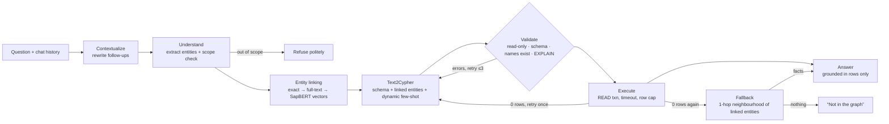

# MediGraph — Graph RAG for medical questions

Ask a medical question in plain English. MediGraph translates it into a **Cypher** query, runs it
against a **Neo4j** knowledge graph of **PrimeKG** (129,375 nodes, 4,050,249 relationships), and has
a locally hosted **Qwen3.5-9B** answer *only* from the rows that came back. Every answer shows the
query, the retrieved rows and the subgraph it was built from.

Everything runs on a laptop (Apple M4, 16 GB): no data leaves the machine.

## Architecture



| Layer | Choice |
|---|---|
| LLM | Qwen3.5-9B (Alibaba, Apache 2.0) via Ollama, thinking off · switchable to OpenAI for comparisons |
| Entity linking | **SapBERT** (`cambridgeltl/SapBERT-from-PubMedBERT-fulltext`, Hugging Face) + Neo4j full-text index |
| Few-shot retrieval | `nomic-embed-text` over a hand-written example bank |
| Graph | Neo4j 5.26 Community (Docker), PrimeKG bulk-loaded with `neo4j-admin import` |
| Orchestration | LangGraph state machine, LangChain model wrappers |
| API / UI | FastAPI with Server-Sent Events · React + TypeScript + vis-network |
| Tooling | uv, pytest, ruff, Make |

## Design decisions

**Knowledge graph instead of a vector store.** Vector search returns passages that *look like* the
question. A graph stores explicit, typed relationships, so the system can answer relational and
multi-hop questions ("which drugs target genes associated with X?", "which of those cause nausea?")
by traversal, and it can say exactly which facts an answer rests on.

**Clean, directed schema.** PrimeKG ships each edge twice with generic relation names. The
importer orients every edge by a fixed label ranking, drops mirrors, and renames relations to
readable verbs (`(:Drug)-[:INDICATED_FOR]->(:Disease)`), which measurably helps the model write
correct Cypher. The relationship count after de-duplication matches the paper exactly (4,050,249).

**SapBERT for entity linking.** General-purpose embeddings put "heart attack" closer to "heart
failure" than to "myocardial infarction". SapBERT is trained on UMLS synonyms for exactly this
task. See `eval/reports/entity_linking.md` for the head-to-head.

## How it handles failure

| Failure | What happens |
|---|---|
| Model writes a write query | Rejected three times over: text check, Neo4j `EXPLAIN` query type must be `r`, and execution in a READ-mode transaction where the server itself refuses writes |
| Invalid Cypher / made-up label, relationship or property | Static schema check + `EXPLAIN`; the precise error (with "did you mean…") is fed back for up to 3 attempts |
| Made-up entity name (`'Bleeding'`) | Every name literal is checked against the graph; closest real names are suggested for the retry |
| Reversed edge direction | Detected statically from the schema, with the valid direction in the error |
| Query returns nothing | One targeted retry; then a fallback that summarises the linked entities' neighbourhood, clearly labelled; if that is empty too, the system says the answer isn't in the graph |
| Question needs personal advice / data the graph lacks | Classified as out of scope and refused, before any query is written |

## How we know it's right: evaluation

`eval/golden_set.jsonl` holds 147 questions across 13 categories: one-hop lookups, multi-hop
traversals, counts, yes/no, lay terms ("Tylenol", "Lou Gehrig's disease"), two-turn follow-ups,
and 12 questions that must be refused. Gold answers are computed by reference Cypher, so
scoring is exact, with no LLM judge. Entities used in the few-shot bank are excluded from the eval.

Metrics: answer recall, **unsupported-claim rate** (entities named in the answer that are not in the
gold set), execution accuracy, retrieval recall, first-try query validity, refusal accuracy,
false-refusal rate, latency. Baselines: the same model answering closed-book, and Llama 3.1 8B in
the same pipeline.

See [`eval/reports/results.md`](eval/reports/results.md).

## Quick start

```bash
make install        # uv venv (Python 3.12) + npm deps
make data           # download PrimeKG (~520 MB) and convert
make import         # bulk-load into Neo4j
make up             # start Neo4j
make setup          # indexes + SapBERT name embeddings
ollama pull qwen3.5:9b && ollama pull nomic-embed-text
make api            # FastAPI on :8000
make ui             # React on :5173
make test           # unit tests
make eval           # run the evaluation (then: uv run python eval/metrics.py)
```

Copy `.env.example` to `.env` to change models or add an OpenAI key for comparison runs.

## Repository layout

```
backend/app/graph/      Neo4j client, schema, entity linker, index/embedding setup
backend/app/pipeline/   LangGraph workflow, nodes, prompts, guards, few-shot bank
backend/app/api/        FastAPI app (SSE streaming)
backend/tests/          unit tests for the query guards
data/scripts/           PrimeKG download + conversion to neo4j-admin CSVs
eval/                   golden set builder, runner, metrics, entity-linking benchmark
frontend/               React UI
```

## Data & disclaimer

PrimeKG: Chandak, Huang & Zitnik, *Building a knowledge graph to enable precision medicine*,
Scientific Data 2023 (CC BY 4.0). This is a research demo, not medical advice; answers reflect only
what PrimeKG contains.
