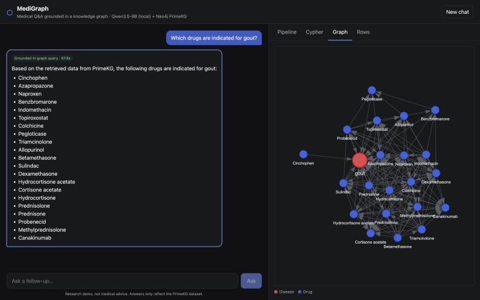
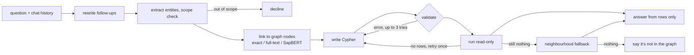
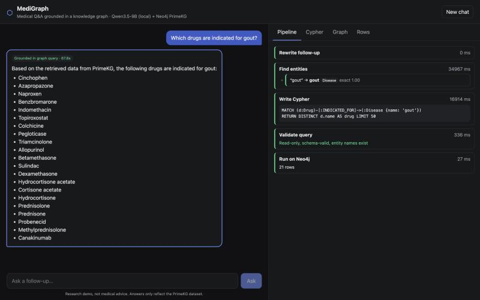

# MediGraph

Ask a medical question in plain English and get an answer that comes from a knowledge graph,
not from the model's memory.

The question gets turned into a Cypher query, the query runs against [PrimeKG](https://github.com/mims-harvard/PrimeKG)
loaded into Neo4j (129,375 nodes, 4,050,249 relationships), and Qwen3.5-9B writes the answer using
only the rows that came back. The UI shows the query, the rows and the subgraph behind every answer.

Everything runs locally on my laptop (M4, 16 GB) through Ollama.



## Why I built it

I wanted to understand where LLMs go wrong on factual questions and what actually keeps them
grounded. Asking a model a medical question directly gives you something fluent that may or may not
be true. Making it query a structured source first means every claim has something underneath it,
and you can check what that is.

I went with a knowledge graph instead of a vector store because the questions I cared about are
about relationships: which drugs treat X, which genes are linked to Y, which of *those* drugs also
cause Z. A graph stores those relationships explicitly, so multi-hop and follow-up questions become
traversals instead of hoping the right text chunks are similar enough to the question.

## How it works



The pipeline is a LangGraph state machine (`backend/app/pipeline/workflow.py`). The UI streams
each step as it runs, so you can see what was linked, the Cypher, and whether validation passed:



A few parts I spent the most time on:

**Entity linking.** Users say "heart attack", the graph says "myocardial infarction". The model
first suggests a standard term, then the linker tries an exact match, a Lucene full-text search and
a vector search. For the vectors I used [SapBERT](https://huggingface.co/cambridgeltl/SapBERT-from-PubMedBERT-fulltext),
which is trained on UMLS synonyms. A general embedding model (nomic-embed-text) put "heart attack"
closer to "heart failure", which is exactly the kind of mistake you can't make here. If the user's
exact wording is already a node name, that wins over whatever the model suggested.

**Query validation.** Before anything runs, the generated Cypher goes through:
- a check for write clauses (CREATE, MERGE, SET, DELETE, CALL ...)
- `EXPLAIN`, where Neo4j reports the query type; anything other than read-only is rejected
- a schema check for made-up labels, relationship types, properties and reversed edges
- a check that every name literal in the query is a real node (the model once wrote
  `{name: 'Bleeding'}`, which doesn't exist; the closest real names get suggested on retry)

Errors are fed back to the model for up to 3 attempts. The query then runs in a READ-mode
transaction with a timeout and a 50-row cap, so even if something slipped past the checks, Neo4j
would refuse to write.

**Empty results.** If the query runs but finds nothing, the model gets one retry with a hint
(usually a reversed edge or the wrong one of two similar names). If that still finds nothing, it
falls back to summarising the linked entities' neighbourhood and says clearly that the exact
relationship wasn't found. If there's nothing at all, it says the answer isn't in the graph.

**Cleaning up PrimeKG.** PrimeKG stores every edge twice with generic relation names. The import
script (`data/scripts/build_import.py`) orients each edge, drops the mirror copy and renames
relations to things like `(:Drug)-[:INDICATED_FOR]->(:Disease)`, which made the model's Cypher a
lot more reliable. After de-duplication the count matches the paper exactly (4,050,249).

## Evaluation

I built a test set of 147 questions (`eval/golden_set.jsonl`) across 13 categories: one-hop
lookups, multi-hop, counts, yes/no, lay terms ("Tylenol", "Lou Gehrig's disease"), two-turn
follow-ups, and 12 questions that should be declined (dosing, prices, made-up diseases). Most are
generated from templates with entities sampled from the graph, and the gold answers come from
reference Cypher queries, so scoring is exact and there's no LLM judge. Entities used in the
few-shot examples are excluded.

The main metric I cared about is **unsupported claims**: drugs, genes or symptoms named in the
answer that are not in the gold answer, the retrieved rows, or the question.

**Full set (147 questions)**

| | answer recall@50 | unsupported claims | exact result match | counts / yes-no | declines correctly | wrong declines | median latency |
|---|---|---|---|---|---|---|---|
| Qwen3.5-9B, no graph | 19.8% | 39.1% | – | 50.0% | 25.0% | 0.0% | 26 s |
| GraphRAG v1 | 94.0% | 0.0% | 91.5% | 94.4% | 100% | 3.0% | 45 s |
| **GraphRAG v2** | **96.8%** | **0.0%** | **93.2%** | **100%** | **100%** | **0.7%** | **37 s** |

**Same 65-question subset (5 per category), comparing models in the same pipeline**

| | answer recall@50 | unsupported claims | exact result match | counts / yes-no | needed fallback | median latency |
|---|---|---|---|---|---|---|
| **Qwen3.5-9B** | **97.8%** | 0.0% | **96.0%** | **100%** | **0%** | 37 s |
| Llama 3.1 8B | 87.8% | 0.0% | 76.0% | 70% | 23% | 21 s |
| Qwen3.5-9B, no graph | 21.2% | 39.6% | – | 40% | – | 28 s |

**Entity linking, 30 lay terms, vector search only** (`eval/link_eval.py`)

| embedder | top-1 | top-5 |
|---|---|---|
| nomic-embed-text | 27% | 57% |
| SapBERT | 57% | 80% |

Full per-category numbers are in [`eval/reports/results.md`](eval/reports/results.md) and every
model output is in `eval/runs/`.

### What the first run got wrong (v1 → v2)

I went through every miss in the first full run. They fell into a few groups:

- **The scope check was too cautious.** "Which drugs should be avoided in patients with X?" was
  refused as personal medical advice (3 cases), and "How many drugs are indicated for X?" was
  read as a request for prevalence statistics. I rewrote the scope rules so only questions about
  the asker's own care are declined.
- **The model "normalised" precise names into different ones.** "Stanolone acetate" became
  "Stanozolol" and "Duane syndrome type 1" became the broader "Duane retraction syndrome". Fix:
  if the user's exact term is a node, use it.
- **Long lists got shortened.** Retrieval returned all 23–27 items but the answer dropped a few.
  Fix: the answer prompt now asks for every retrieved item.

That took the wrong-decline rate from 3.0% to 0.7% and exact matches from 91.5% to 93.2%. The one
remaining wrong decline was the scope check deciding "H TYPE II TRISACCHARIDE" isn't a real drug
even though it's in the graph; the prompt now tells it not to judge that.

Some of the misses were in my scoring, not the system: names like "Estradiol" inside "Estradiol
acetate", HPO terms that are ordinary words ("Severe", "Pain"), and questions whose true answer has
more than 50 items. Those are handled in `eval/metrics.py` and documented at the top of the file.

## Limitations

- **Gold answers come from the same graph.** The eval measures whether the system answers
  faithfully to PrimeKG, not whether PrimeKG is medically complete or current. A question like
  "what treats cancer?" returns three drugs because that's what the graph says.
- **It's slow on my machine.** About 37 s per question with a 9B model on a 16 GB laptop that is
  also running Neo4j. Almost all of that is the LLM; the Neo4j queries take tens of milliseconds.
  I tried routing the easy steps to Qwen3.5-2B, but with two models in memory the laptop swapped
  more and it got slower overall. It's still an option in the config.
- **Template questions.** Most eval questions are generated from templates, so the phrasing is
  less varied than real users.
- **Follow-ups referring to many items** sometimes get a query for only the first one. I've seen
  it once in the eval, not fixed yet.
- **Not medical advice.** It's a research demo over one dataset.

## Stack

| | |
|---|---|
| LLM | Qwen3.5-9B through Ollama (thinking off). OpenAI can be swapped in for comparisons |
| Entity linking | SapBERT (Hugging Face) + Neo4j full-text index |
| Few-shot retrieval | nomic-embed-text over a small hand-written example bank |
| Graph | Neo4j 5.26 Community in Docker, PrimeKG loaded with `neo4j-admin import` |
| Pipeline | LangGraph, LangChain model wrappers |
| API / UI | FastAPI with server-sent events, React + TypeScript + vis-network |
| Tooling | uv, pytest, ruff, Make |

## Running it

You need Docker, [Ollama](https://ollama.com), [uv](https://docs.astral.sh/uv/) and Node.

```bash
ollama pull qwen3.5:9b
ollama pull nomic-embed-text
make install        # Python env + frontend deps
make data           # download PrimeKG (~520 MB) and build the import CSVs
make import         # bulk load into Neo4j
make up             # start Neo4j
make setup          # indexes + SapBERT name embeddings (~5 min)
make api            # FastAPI on :8000
make ui             # React on :5173
```

`make test` runs the unit tests for the query checks. To reproduce the eval:

```bash
uv run python eval/build_golden.py
uv run python eval/run_eval.py --system graphrag
uv run python eval/run_eval.py --system closed_book
uv run python eval/metrics.py
```

Copy `.env.example` to `.env` to change models or add an OpenAI key.

## More docs

- [`docs/decision.md`](docs/decision.md): every design decision, the alternatives I considered and the trade-offs
- [`docs/flow.md`](docs/flow.md): how the code runs, entry points, execution order and call chains between files

## Layout

```
backend/app/graph/      Neo4j client, schema, entity linker, index + embedding setup
backend/app/pipeline/   LangGraph workflow, nodes, prompts, query checks, few-shot examples
backend/app/api/        FastAPI app
backend/tests/          tests for the query checks
data/scripts/           PrimeKG download and conversion
eval/                   test set builder, runner, metrics, entity-linking benchmark, results
docs/                   design decisions, code flow, screenshots
frontend/               React UI
```

## Data

PrimeKG: Chandak, Huang & Zitnik, *Building a knowledge graph to enable precision medicine*,
Scientific Data (2023), CC BY 4.0.
