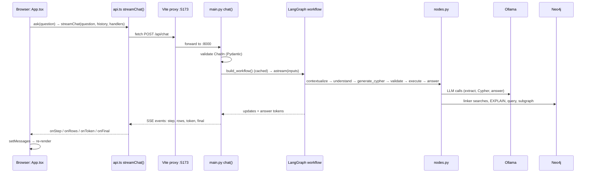
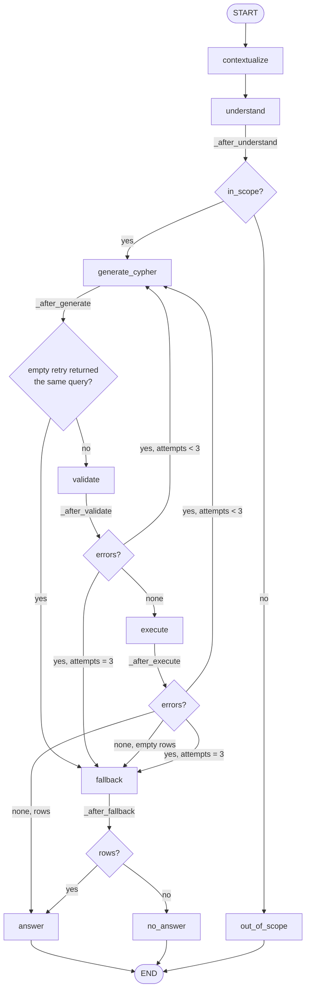
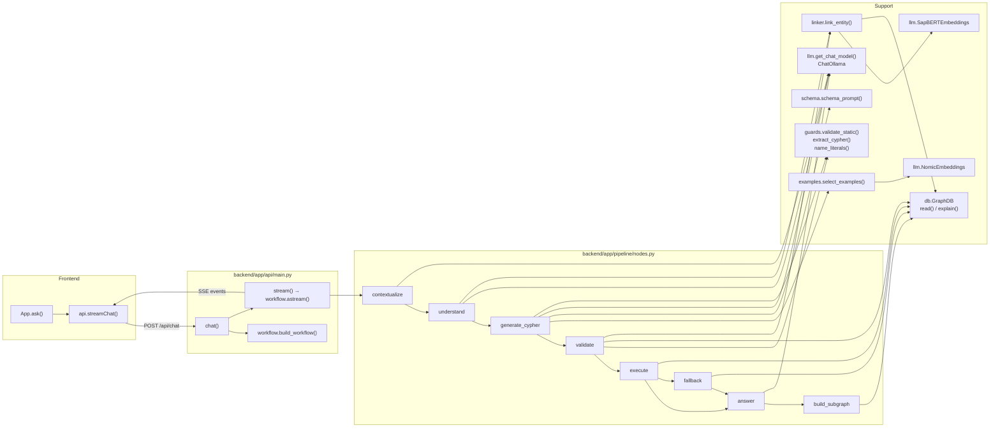

# Code flow

How the code runs: every entry point, the order things execute in, which function calls which,
and how data moves between files. Function and file names match the code exactly, so you can
follow along with the source open.

## Contents

1. [Repository map](#1-repository-map)
2. [Entry points](#2-entry-points)
3. [Offline flow 1: building the import CSVs](#3-offline-flow-1-building-the-import-csvs)
4. [Offline flow 2: bulk import](#4-offline-flow-2-bulk-import)
5. [Offline flow 3: indexes and embeddings](#5-offline-flow-3-indexes-and-embeddings)
6. [Server startup: what happens on import](#6-server-startup-what-happens-on-import)
7. [Request flow: one question, start to finish](#7-request-flow-one-question-start-to-finish)
8. [Each pipeline node, call by call](#8-each-pipeline-node-call-by-call)
9. [Routing: how the next node is chosen](#9-routing-how-the-next-node-is-chosen)
10. [The shared state: who writes what](#10-the-shared-state-who-writes-what)
11. [From pipeline to browser: the event stream](#11-from-pipeline-to-browser-the-event-stream)
12. [Frontend flow](#12-frontend-flow)
13. [A worked trace with state snapshots](#13-a-worked-trace-with-state-snapshots)
14. [Evaluation flow](#14-evaluation-flow)
15. [Tests](#15-tests)
16. [Configuration and caching](#16-configuration-and-caching)
17. [Where errors are caught](#17-where-errors-are-caught)
18. [Full call graph](#18-full-call-graph)

---

## 1. Repository map

```
medigraph_llm_rag/
├── Makefile                      command entry points (make up, make api, ...)
├── docker-compose.yml            Neo4j container
├── pyproject.toml / uv.lock      Python dependencies, pytest and ruff settings
├── .env / .env.example           configuration (read by backend/app/config.py)
├── data/
│   ├── scripts/download_primekg.sh   download raw PrimeKG files
│   ├── scripts/build_import.py       raw PrimeKG → Neo4j import CSVs
│   ├── raw/                          downloaded files (git-ignored)
│   └── import/                       nodes.csv, relationships.csv (git-ignored)
├── backend/
│   ├── app/
│   │   ├── config.py             Settings + get_settings()
│   │   ├── llm.py                get_chat_model(), NomicEmbeddings, SapBERTEmbeddings
│   │   ├── graph/
│   │   │   ├── db.py             GraphDB (read, explain, write) + get_db()
│   │   │   ├── schema.py         labels, relationships, schema_prompt()
│   │   │   ├── linker.py         link_entity() and its helpers
│   │   │   └── setup.py          one-off: indexes + embeddings
│   │   ├── pipeline/
│   │   │   ├── state.py          GraphRAGState (the shared state)
│   │   │   ├── workflow.py       build_workflow(), routing functions, run()
│   │   │   ├── nodes.py          the 9 node functions
│   │   │   ├── prompts.py        all prompt templates
│   │   │   ├── guards.py         static query checks
│   │   │   └── examples.py       few-shot bank + select_examples()
│   │   └── api/main.py           FastAPI app, /api/chat stream
│   └── tests/test_guards.py      unit tests for guards.py
├── frontend/
│   ├── index.html                loads src/main.tsx
│   ├── vite.config.ts            dev server + /api proxy to :8000
│   └── src/
│       ├── main.tsx              mounts <App />
│       ├── App.tsx               chat UI, evidence panel
│       ├── api.ts                streamChat(): POST + SSE parsing
│       └── GraphView.tsx         subgraph drawing (vis-network)
└── eval/
    ├── build_golden.py           creates golden_set.jsonl
    ├── run_eval.py               runs a system over the golden set
    ├── metrics.py                scores runs → reports/results.md
    ├── link_eval.py              entity-linking benchmark
    └── run_all.sh                runs several evaluations in sequence
```

Python imports use the package root `backend/`: modules are imported as `app.config`,
`app.pipeline.nodes`, and so on. That's why commands use `--app-dir backend`
(uvicorn), `cd backend` (setup), `sys.path.insert(0, "backend")` (eval scripts) or
`pythonpath = ["backend"]` (pytest, in `pyproject.toml`).

---

## 2. Entry points

| Command | What starts | First function that runs |
|---|---|---|
| `make data` | `data/scripts/download_primekg.sh`, then `data/scripts/build_import.py` | `fetch()` in the shell script; then `build_import.main()` |
| `make import` | `neo4j-admin database import` inside the Neo4j Docker image | (Neo4j tool, reads `data/import/*.csv`) |
| `make up` | `docker compose up -d --wait` | Neo4j server; returns when the healthcheck passes |
| `make setup` | `python -m app.graph.setup` (from `backend/`) | `setup.main()` |
| `make api` | `uvicorn app.api.main:app --app-dir backend` | module import of `app/api/main.py` (section 6), then `chat()` per request |
| `make ui` | `vite` dev server in `frontend/` | browser loads `index.html` → `src/main.tsx` |
| `make test` | `pytest` | test functions in `backend/tests/test_guards.py` |
| `uv run python eval/build_golden.py` | golden set builder | `build_golden.main()` |
| `uv run python eval/run_eval.py ...` | evaluation runner | `run_eval.main()` |
| `uv run python eval/metrics.py` | scoring | `metrics.main()` |
| `uv run python eval/link_eval.py` | linking benchmark | `link_eval.main()` |
| `eval/run_all.sh` | several `run_eval.py` runs, then `metrics.py` | `run()` shell function |

The order to set everything up from scratch is: `make install` → `make data` → `make import` →
`make up` → `make setup` → `make api` + `make ui`.

---

## 3. Offline flow 1: building the import CSVs

`data/scripts/build_import.py`, started by `make data`.

```
main()
├── OUT.mkdir()                                   data/import/
├── build_nodes()                                 → DataFrame of 129,375 nodes
│   ├── pd.read_csv("raw/nodes.tab")              node_index, node_id, node_type, node_name, node_source
│   ├── check every node_type is in LABELS        (exit if an unknown type appears)
│   ├── nodes["label"] = node_type → LABELS       "gene/protein" → "Gene", ...
│   ├── pd.read_csv("raw/drug_features.tab")
│   │   └── first_non_empty(...) → clean_text()   description, mechanism
│   ├── pd.read_csv("raw/disease_features.tab")
│   │   └── first_non_empty(...) → clean_text()   description, symptoms
│   └── nodes.join(text, on="node_index")
├── build_edges(nodes)                            → DataFrame of 4,050,249 edges
│   ├── pd.read_csv("raw/edges.csv")              8,100,498 rows: relation, display_relation, x_index, y_index
│   ├── relation → RELATIONS                      "indication" → "INDICATED_FOR", ...
│   ├── drug_protein rows: display_relation → DRUG_PROTEIN   "target" → "TARGETS", ...
│   ├── (exit if any relation is unmapped)
│   ├── rank = label → RANK                       Drug 0, Disease 1, ..., Gene 9
│   ├── swap x/y where rank(x) > rank(y), or same rank and x_index > y_index
│   └── drop_duplicates()                         mirror copies removed
├── write data/import/nodes.csv                   node_index:ID, name, source_id, source,
│                                                 description, mechanism, symptoms, :LABEL
├── write data/import/relationships.csv           :START_ID, :END_ID, :TYPE
└── print counts per label and per type
```

---

## 4. Offline flow 2: bulk import

`make import` runs, inside the Neo4j image (no Python involved):

```
docker compose down
docker compose run --rm --no-deps neo4j neo4j-admin database import full neo4j \
    --overwrite-destination --id-type=integer \
    --nodes=/import/nodes.csv --relationships=/import/relationships.csv
```

`docker-compose.yml` mounts `./data/import` at `/import` and stores the database in the
`neo4j_data` volume. After this, `make up` starts the server on ports 7474 (browser) and 7687 (Bolt).

---

## 5. Offline flow 3: indexes and embeddings

`backend/app/graph/setup.py`, started by `make setup` (`python -m app.graph.setup`).

```
main()
├── argparse: --skip-embeddings, --embedder sapbert|nomic|both (default sapbert)
├── create_indexes()
│   ├── get_db()                                  → GraphDB (cached, section 16)
│   ├── for each label in NODE_LABELS:
│   │   ├── db.write("CREATE INDEX <label>_name ... ON (n.name)")
│   │   └── db.write("CREATE INDEX <label>_idx  ... ON (n.node_index)")
│   ├── db.write("CREATE FULLTEXT INDEX entity_names FOR (n:Disease|Drug|...) ON EACH [n.name]")
│   └── db.write("CALL db.awaitIndexes(300)")
└── for kind in [sapbert] (or both):
    └── embed_names(kind)
        ├── get_entity_embeddings(kind)            → SapBERTEmbeddings() (loads model from Hugging Face)
        ├── prop = VECTOR_PROPERTY[kind]           "sapbert"
        ├── dimensions = len(emb.embed_query("test"))   768
        └── for label in EMBEDDED_LABELS[kind]:   Disease, Drug, Phenotype, Exposure, Anatomy, Gene, Pathway
            ├── db.read("MATCH (n:<label>) WHERE n.sapbert IS NULL RETURN idx, name")
            ├── for each batch of 64 names:
            │   ├── _embed_with_retry(emb, names)  → emb.embed_documents(names), retried on errors
            │   └── db.write("UNWIND $rows ... CALL db.create.setNodeVectorProperty(n, 'sapbert', row.vec)")
            └── db.write("CREATE VECTOR INDEX sapbert_<label> ... 768 dims, cosine")
        └── db.write("CALL db.awaitIndexes(600)")
```

This is the only code path that writes to Neo4j (via `GraphDB.write`). The request pipeline never
calls `write`.

---

## 6. Server startup: what happens on import

`uvicorn app.api.main:app --app-dir backend --port 8000` imports `app/api/main.py`. Imports run top
to bottom and pull in the rest of the backend:

```
app/api/main.py
├── app.config            → defines Settings, get_settings (nothing read yet)
├── app.graph.db          → defines GraphDB, get_db (no connection yet)
├── app.graph.schema      → builds NODE_LABELS, RELATIONSHIPS, REL_TYPES, ALL_PROPERTIES (plain data)
└── app.pipeline.workflow
    ├── app.pipeline.nodes
    │   ├── app.graph.linker   → app.llm (defines model factories; no model loaded)
    │   ├── app.pipeline.prompts       (string templates)
    │   ├── app.pipeline.examples      (EXAMPLES list; vectors computed lazily)
    │   ├── app.pipeline.guards        (compiles regexes)
    │   └── app.pipeline.state         (GraphRAGState type)
    └── defines build_workflow() (not called yet)
```

Then module-level code in `main.py` runs:

1. `app = FastAPI(...)`
2. `app.add_middleware(CORSMiddleware, allow_origins=[localhost:5173, ...])`
3. Route functions are registered: `health`, `schema`, `examples`, `chat`.

**Nothing expensive happens at startup.** The Neo4j driver, SapBERT, the nomic client and the
compiled graph are all created on first use and then cached (section 16). The first question is
therefore slower (it loads SapBERT and connects to Neo4j); later ones reuse everything.

---

## 7. Request flow: one question, start to finish



Step by step:

1. **`App.ask(question)`** (`frontend/src/App.tsx`) builds `history` from earlier messages, adds the
   user message and an empty "pending" assistant message, then calls `streamChat()`.
2. **`streamChat()`** (`frontend/src/api.ts`) sends `fetch('/api/chat', {method: 'POST', body:
   {question, history}})`.
3. **Vite** (`vite.config.ts`) proxies `/api` to `http://localhost:8000`.
4. **FastAPI** parses the body into `ChatIn` (question 2–1,000 chars, history ≤ 20 turns, each
   `TurnIn` with role `user|assistant`). Invalid → 422 response; `chat()` never runs.
5. **`chat(body)`** (`backend/app/api/main.py`) gets the compiled graph from `build_workflow()`, builds
   `inputs = {"question": ..., "history": [...]}` and returns
   `EventSourceResponse(stream())`.
6. **`stream()`**, an async generator, calls
   `workflow.astream(inputs, {"recursion_limit": 30}, stream_mode=["updates", "messages"])`.
7. **LangGraph** runs nodes in the order decided by the routing functions (section 9). Normal path:
   `contextualize → understand → generate_cypher → validate → execute → answer → END`.
8. As each node finishes, `stream()` turns its output into SSE events (section 11). Tokens produced
   inside the `answer` node become `token` events.
9. After the graph ends, `stream()` sends one `final` event (answer, status, subgraph, total ms).
10. **`streamChat()`** parses events and calls the handlers passed in by `App`, which update React state;
    the UI re-renders live.

---

## 8. Each pipeline node, call by call

All in `backend/app/pipeline/nodes.py`. Every node receives the current state (and the run
`config`), and returns a dict with only the fields it changed.

Helper used by several nodes:

```
_llm(config, fast=False)
├── read config["configurable"]: provider, model, fast_model
├── if fast and no override and provider is ollama: use settings.ollama_fast_model (empty by default)
└── get_chat_model(provider, model)                (app/llm.py)
    └── ChatOllama(model="qwen3.5:9b", temperature=0, num_ctx=8192, reasoning=False, keep_alive="30m")
        or ChatOpenAI(...) when provider == "openai"

_trace(step, start, **detail) → [{"step": ..., "ms": ..., **detail}]
```

### 8.1 `contextualize(state, config)`

```
if no history:
    return {standalone_question: question, trace}           (no LLM call)
convo = last 6 turns, each cut to 800 chars
prompt = prompts.CONTEXTUALIZE.format(history=convo, question=question)
_llm(config, fast=True).invoke(prompt)                       → Ollama
return {standalone_question: rewritten (or original if empty), trace}
```

### 8.2 `understand(state, config)`

```
extractor = _llm(config, fast=True).with_structured_output(Extraction)
parsed = extractor.invoke(prompts.EXTRACT.format(question=standalone_question))   → Ollama (JSON schema)
    on any exception: parsed = Extraction(entities=[], in_scope=True)
db = get_db()
for m in parsed.entities[:10]:
    label = m.type if it's a known label else None
    own = link_entity(db, m.mention, label)                 (section 8.2.1)
    if own[0] is an exact match:  candidates = own
    else:                         candidates = own (+ link_entity(db, m.canonical, label) if different)
    if no candidates and label:   candidates = link_entity(db, m.canonical, None)
    sort candidates: exact first, then by score
    linked.append({best..., mention, alternatives: next 2 names})
return {entities: linked, in_scope, scope_reason, trace}
```

#### 8.2.1 `link_entity(db, mention, label)` (`backend/app/graph/linker.py`)

```
k = settings.entity_candidates (3)
1. Exact:
   variants = [mention, lower, Capitalized, UPPER]
   db.read( UNION of "MATCH (n:<lab>) WHERE n.name IN $names RETURN ..." for each label )
   if found → return [LinkedEntity(..., score=1.0, method="exact")]
2. Candidates:
   emb = get_entity_embeddings()                      → SapBERTEmbeddings (cached)
   vector = emb.embed_query(mention)                  → PyTorch on MPS
   fulltext_candidates(db, mention, label, k)
   │   └── _lucene_escape(), build '"phrase"^3 OR (term~1 AND ...)'
   │       db.read("CALL db.index.fulltext.queryNodes('entity_names', $query) ...")
   vector_candidates(db, mention, vector, label, k)
   │   └── for each embedded label (or just `label`):
   │       db.read("CALL db.index.vector.queryNodes('sapbert_<label>', $k, $vector) ...")
   │       (ClientError → skip that label)
   merge by node_index (marks "fulltext+vector" when both found it)
3. Re-score:
   name_vectors = emb.embed_documents([candidate names])
   score = 0.85 × _cosine(vector, name_vector) + 0.15 × SequenceMatcher(mention, name).ratio()
4. Filter: keep score ≥ MIN_SCORE["sapbert"] (0.55), sort, return top k
```

### 8.3 `generate_cypher(state, config)`

```
examples = select_examples(standalone_question)            (app/pipeline/examples.py)
│   ├── get_embeddings()                                    → NomicEmbeddings (cached)
│   ├── q = embed_query(question), normalised
│   ├── _example_vectors()                                  (cached: all 22 example questions, normalised)
│   └── top 4 by cosine → [(question, cypher), ...]
system = prompts.TEXT2CYPHER.format(
    schema   = schema_prompt(),                             (app/graph/schema.py)
    entities = _entities_block(state.entities),             '- "gout" -> (:Disease {name: "gout"})'
    examples = formatted examples)
messages = [SystemMessage(system), HumanMessage("Question: ...\nCypher:")]
if this is a retry (state.errors and state.cypher):
    messages += [AIMessage(previous cypher),
                 HumanMessage(prompts.TEXT2CYPHER_RETRY.format(cypher=..., errors=...))]
reply = _llm(config).invoke(messages)                       → Ollama
cypher = extract_cypher(reply.content)                      (guards.py: strip fences, "cypher:", ";")
return {cypher, attempts: attempts + 1, errors: [], trace}
```

### 8.4 `validate(state)`

```
errors = validate_static(cypher)                             (guards.py)
│   ├── empty → error;  no RETURN → error
│   ├── check_read_only(cypher)
│   │   ├── _strip_strings()   blank out quoted literals
│   │   ├── ";" present → error
│   │   └── WRITE_CLAUSES regex match → error
│   └── check_schema(cypher)   (only if read-only passed)
│       ├── properties not in ALL_PROPERTIES → error + _suggest()
│       ├── :Labels / :TYPES not known → error + _suggest()
│       └── (:A)-[:REL]->(:B) not in REL_DIRECTIONS → error with valid patterns
if no errors:
    get_db().explain(cypher)                                 → Neo4j "EXPLAIN ..."
    query_type != "r" → error;  Neo4jError → "Neo4j rejected the query: ..."
if no errors:
    check_entity_names(cypher)                               (nodes.py)
    ├── name_literals(cypher)                                (guards.py) → [(label, name), ...]
    └── for each: db.read(UNION of "MATCH (n:<lab> {name: $name}) RETURN 1")
        not found → link_entity(db, name, label) for suggestions → error
return {errors, attempt_log: [{attempt, cypher, errors}], trace}
```

### 8.5 `execute(state)`

```
get_db().read(cypher)                                        (graph/db.py)
├── neo4j.Query(cypher, timeout=10 s)
├── driver.session(default_access_mode=READ_ACCESS)
├── iterate records; stop at max_result_rows (50) → truncated=True
└── each value → _to_plain()   Node/Relationship/Path → dicts; hides embedding properties
on Neo4jError: return {errors: ["Execution failed: ..."], rows: [], trace}
if _is_empty(rows) and not empty_retry_done:
    add {empty_retry_done: True, errors: ["The query ran but returned no results. ..."]}
return {rows, truncated, trace, (errors, empty_retry_done)}
```

### 8.6 `fallback(state)`

```
for up to 3 linked entities (label must be in NODE_LABELS):
    db.read("MATCH (n:<label> {node_index: $idx})-[r]-(m) ... relationship, direction,
             other_label, total, names[..8] ... LIMIT 12")
    db.read("MATCH (n:<label> {node_index: $idx}) RETURN description, mechanism, symptoms")
return {rows, truncated: False, used_fallback: True, trace}
```

### 8.7 `answer(state, config)`

```
rows = _compact(state.rows)                                  strings > 500 chars cut
prompt = prompts.ANSWER.format(
    fallback_note = prompts.FALLBACK_NOTE if used_fallback else "",
    question, cypher (or "(neighbourhood lookup)"), n_rows, truncated,
    rows = json.dumps(rows)[:12000])
reply = _llm(config).invoke(prompt)                          → Ollama (tokens streamed, section 11)
return {answer, status: "answered" | "fallback", subgraph: build_subgraph(state), trace}
```

### 8.8 `no_answer(state)` and `out_of_scope(state)`

```
no_answer:     {answer: prompts.NO_ANSWER (fixed text), status: "no_answer", subgraph: build_subgraph(state)}
out_of_scope:  {answer: template using scope_reason, status: "out_of_scope", subgraph: build_subgraph(state)}
```

No LLM call in either.

### 8.9 `build_subgraph(state)` (used by the three terminal nodes)

```
seeds = names of linked entities
names = seeds + every short string found in rows (_strings())       max 120
db.read( UNION ALL of "MATCH (n:<label>) WHERE n.name IN $names RETURN elementId(n), name, label, seed"
         for every label )                                            max 60 nodes
db.read("MATCH (a)-[r]->(b) WHERE elementId(a) IN $ids AND elementId(b) IN $ids RETURN ...")  max 200 edges
return {nodes, edges}
```

---

## 9. Routing: how the next node is chosen

Defined in `backend/app/pipeline/workflow.py`. Fixed edges always go the same way; conditional edges
call a routing function on the state.



| Routing function | Reads | Returns |
|---|---|---|
| `_after_understand` | `in_scope` | `"generate_cypher"` or `"out_of_scope"` |
| `_after_generate` | `empty_retry_done`, `attempt_log[-1].cypher`, `cypher` | `"fallback"` if the model returned the same query after an empty-result retry, else `"validate"` |
| `_after_validate` | `errors`, `attempts`, `max_cypher_attempts` | `"execute"`, `"generate_cypher"` or `"fallback"` |
| `_after_execute` | `errors`, `rows`, `attempts` | `"answer"`, `"fallback"` (empty) or `"generate_cypher"` (error or first empty result) |
| `_after_fallback` | `rows` | `"answer"` or `"no_answer"` |

Note on empty results: `execute` sets `errors` on the *first* empty result (and
`empty_retry_done=True`). `_after_execute` sees errors and routes back to `generate_cypher` if
attempts remain. On a *second* empty result, `execute` doesn't set errors (the flag is already set),
so `_after_execute` sees no errors and empty rows, and routes to `fallback`.

`build_workflow()` registers the 9 nodes, adds `START → contextualize → understand`, the five
conditional edges above, and `answer / no_answer / out_of_scope → END`, then compiles. It's
`@lru_cache`d, so compilation happens once per process.

---

## 10. The shared state: who writes what

`GraphRAGState` in `backend/app/pipeline/state.py`. A node's returned dict is merged into the state.
Fields marked "append" use the `operator.add` reducer (lists are concatenated); all others are
overwritten.

| Field | Written by | Read by |
|---|---|---|
| `question`, `history` | input (API or `run()`) | contextualize |
| `standalone_question` | contextualize | understand, generate_cypher, answer |
| `entities` | understand | generate_cypher, fallback, build_subgraph |
| `in_scope`, `scope_reason` | understand | `_after_understand`, out_of_scope |
| `cypher` | generate_cypher | validate, execute, answer, `_after_generate`, retry prompt |
| `attempts` | generate_cypher (+1 each time) | `_after_validate`, `_after_execute` |
| `errors` | generate_cypher (clears), validate, execute | routing, retry prompt |
| `attempt_log` (append) | validate | `_after_generate`, evaluation |
| `empty_retry_done` | execute | execute, `_after_generate` |
| `rows`, `truncated` | execute, fallback | routing, answer, build_subgraph |
| `used_fallback` | fallback | answer |
| `answer`, `status`, `subgraph` | answer / no_answer / out_of_scope | API final event, evaluation |
| `trace` (append) | every node except the terminals' no_answer/out_of_scope | API step events, evaluation |

---

## 11. From pipeline to browser: the event stream

Inside `chat()` → `stream()` in `backend/app/api/main.py`:

```
async for mode, chunk in workflow.astream(..., stream_mode=["updates", "messages"]):
    if mode == "messages":
        message, meta = chunk
        if meta["langgraph_node"] == "answer" and message.content:
            yield event("token", {"text": message.content})       # answer text, piece by piece
        continue
    for node, update in chunk.items():                           # mode == "updates"
        if node in STEP_EVENTS:                                  # contextualize ... fallback
            for t in update["trace"]: yield event("step", t)
            if node == "execute":  yield event("rows", {rows[:50], truncated})
            if node == "fallback": yield event("rows", {rows, fallback: True})
        if node in FINAL_NODES:                                  # answer, no_answer, out_of_scope
            final = update
yield event("final", {answer, status, subgraph, ms})
on any exception: yield event("error", {message})
```

- `"updates"` mode yields `{node_name: returned_dict}` after each node finishes.
- `"messages"` mode yields LLM output pieces with metadata about which node produced them. Only
  pieces from the `answer` node are forwarded, so the user doesn't see raw Cypher or JSON streaming.
- `EventSourceResponse` (sse-starlette) formats each dict as `event: <name>\ndata: <json>\n\n`.

| SSE event | Produced from | Frontend handler |
|---|---|---|
| `step` | each trace entry of a step node | `onStep` → appends to the message's steps; updates Cypher tab |
| `rows` | execute / fallback update | `onRows` → Rows tab |
| `token` | answer node LLM output | `onToken` → appends text to the answer |
| `final` | terminal node update | `onFinal` → final answer, status badge, subgraph, time |
| `error` | exception in the stream | `onError` → error text |

---

## 12. Frontend flow

```
index.html
└── <script type="module" src="/src/main.tsx">
    └── main.tsx: createRoot(#root).render(<StrictMode><App/></StrictMode>)
        └── App()
            ├── state: messages, input, busy, selected, tab, examples
            ├── useEffect (mount): fetch('/api/examples') → setExamples
            ├── useEffect (messages change): scroll to bottom
            ├── render: header, chat (messages or example chips), composer, evidence panel
            └── ask(question)                                   on submit or chip click
                ├── history = previous messages without pending/error
                ├── append user message + pending assistant message (with empty evidence)
                └── await streamChat(question, history, handlers)      (api.ts)
                    ├── fetch POST /api/chat
                    ├── reader = res.body.getReader()
                    └── loop: read chunk → buffer → split on "\n\n" → parse "event:" / "data:"
                        ├── step  → onStep:  evidence.steps.push(step); cypher = step.cypher if generate_cypher
                        ├── rows  → onRows:  evidence.rows = rows
                        ├── token → onToken: message.content += text
                        ├── final → onFinal: content = answer; evidence.subgraph/status/ms; switch to Graph tab
                        └── error → onError: message.error = text
```

Rendering components (all in `App.tsx` except `GraphView`):

| Component | Shows | Data |
|---|---|---|
| `Steps` / `StepDetail` | Pipeline tab: each step, time, entities, Cypher, validation errors, row counts | `evidence.steps` |
| `<pre class="code">` | Cypher tab | `evidence.cypher` |
| `GraphView` (`GraphView.tsx`) | Graph tab: vis-network `DataSet`s of nodes and edges; seeds drawn larger; colour by label | `evidence.subgraph` |
| `Rows` | Rows tab: table of raw rows | `evidence.rows` |
| `Markdown` | The answer text (paragraphs, bullets, bold) | `message.content` |

---

## 13. A worked trace with state snapshots

Question: **"What drugs treat a heart attack?"** (no history). Times are from a real run.

| # | Node | What happened | State after (changed fields) |
|---|---|---|---|
| 0 | input | from `ChatIn` | `question`, `history: []` |
| 1 | contextualize | no history → no LLM call (0 ms) | `standalone_question: "What drugs treat a heart attack?"` |
| 2 | understand | LLM returns `[{mention: "heart attack", canonical: "myocardial infarction", type: "Disease"}]`, `in_scope: true`. `link_entity("heart attack")`: no exact match → candidates, but `link_entity("myocardial infarction")` → exact match, sorted first (~15 s) | `entities: [{name: "myocardial infarction", label: "Disease", score: 1.0, method: "exact", ...}]`, `in_scope: true` |
| — | `_after_understand` | in scope | → generate_cypher |
| 3 | generate_cypher | 4 examples chosen; prompt built; LLM writes the query (~12 s) | `cypher: "MATCH (d:Drug)-[:INDICATED_FOR]->(:Disease {name: 'myocardial infarction'}) RETURN DISTINCT d.name AS drug LIMIT 50"`, `attempts: 1`, `errors: []` |
| — | `_after_generate` | no empty retry | → validate |
| 4 | validate | static checks pass; EXPLAIN type `r`; name exists (~0.2 s) | `errors: []`, `attempt_log: [{attempt: 1, ..., errors: []}]` |
| — | `_after_validate` | no errors | → execute |
| 5 | execute | 9 rows (~30 ms) | `rows: [{drug: "Alteplase"}, ...]`, `truncated: false` |
| — | `_after_execute` | rows present | → answer |
| 6 | answer | answer prompt with 9 rows; LLM lists them (~13 s); `build_subgraph` | `answer`, `status: "answered"`, `subgraph: {nodes: 10, edges: ...}` |
| — | END | `stream()` sends `final` | |

Events the browser received, in order: `step(contextualize)`, `step(understand)`,
`step(generate_cypher)`, `step(validate)`, `step(execute)`, `rows`, many `token`s, `final`.

A retry looks like this instead (from the evaluation, "What is Klinefelter syndrome treated with?"):

```
generate_cypher (attempt 1) → validate: errors ["(:Disease)-[:INDICATED_FOR]->(:Drug) does not exist. Valid: ..."]
_after_validate: attempts 1 < 3 → generate_cypher
generate_cypher (attempt 2, with AIMessage(previous query) + HumanMessage(errors)) → validate: ok
→ execute (6 rows) → answer
```

---

## 14. Evaluation flow

### 14.1 Building the test set: `eval/build_golden.py`

```
main()
├── get_db(); rng = Random(7)
├── for each category in LIST_TEMPLATES (8 categories):
│   └── sample_subjects(db, subject_label, reference_cypher, bounds, rng)
│       ├── db.read(  MATCH (s:<label>) ... CALL (name) { <reference cypher> } ...
│       │             WHERE answers between bounds )                 timeout 300 s
│       ├── keep clean_name() subjects (not in LEAKED, no brackets, 4–45 chars)
│       └── shuffle → first 12 → question from template, gold = answers
├── counts (8): same sampling, gold = len(answers)
├── yes/no (10): contraindication pairs; every other one replaced with a non-contraindicated disease
├── lay terms: hand-written list, gold from reference cypher on the canonical name
├── follow-ups (10): disease with 4–15 drugs + a side effect some of them have; history = first turn
├── unanswerable (12): fixed list, gold = None
└── write eval/golden_set.jsonl with ids q000...
```

### 14.2 Running a system: `eval/run_eval.py`

```
main()
├── argparse: --system graphrag|closed_book, --provider, --model, --fast-model,
│             --limit, --per-category, --category, --name
├── decide model, fast_model, run name → eval/runs/<name>.jsonl
├── load golden set; filter by category / per-category / limit
├── skip ids already in the output file (resumable)
└── for each question:
    ├── graphrag:     run_graphrag(item, ...)
    │   └── workflow.run(question, history, provider, model, fast_model)
    │       └── build_workflow().invoke(inputs, {"configurable": {...}, "recursion_limit": 30})
    │           (same nodes and routing as the API, but invoke() returns the final state)
    │       → record answer, status, entities, cypher, attempts, first_try_valid,
    │         attempt_errors, rows, truncated, used_fallback, trace_ms
    ├── closed_book:  run_closed_book(item, ...)
    │   └── get_chat_model(provider, model).invoke(CLOSED_BOOK_PROMPT)  (no graph at all)
    ├── exceptions → recorded as status "error"
    └── append one JSON line, flush, print progress
```

### 14.3 Scoring: `eval/metrics.py`

```
main()
├── golden = {id: item}
├── for each eval/runs/*.jsonl:
│   ├── for each record: score(golden[id], record)
│   │   ├── refusal detection (status, or REFUSAL regex for list questions)
│   │   ├── refuse questions → refusal_correct
│   │   ├── list questions:
│   │   │   ├── mentioned(answer, label)                  → names_by_label(label) (cached db.read)
│   │   │   ├── mentioned(answer, label, strict_case=True) for extra claims
│   │   │   ├── evidence = strings(rows) + question + history
│   │   │   ├── answer_recall, unsupported_rate, off_gold_rate
│   │   │   └── graphrag: retrieval_recall, exec_accuracy (from rows vs gold, @50)
│   │   ├── count → value_correct (number in answer)
│   │   └── boolean → value_correct (predicted_bool(answer) == gold)
│   ├── summarize(scores) → means, latency p50 / p95
│   └── per-category summaries
└── write eval/reports/results.md and results.json
```

### 14.4 Linking benchmark: `eval/link_eval.py`

```
main()
├── check every gold name in CASES exists
└── for kind in (nomic, sapbert):
    └── evaluate(kind)
        ├── emb = get_entity_embeddings(kind)
        └── for (mention, label, gold) in CASES:
            db.read("CALL db.index.vector.queryNodes(vector_index_name(label, kind), 5, $v)")
            → top-1 / top-5 hits, misses
→ print and write eval/reports/entity_linking.md
```

### 14.5 Queueing runs: `eval/run_all.sh`

Runs `run_eval.py` for v2, closed-book and Llama (65 questions) one after another, unloading models
between them with `ollama stop`, then `metrics.py`.

---

## 15. Tests

```
make test → uv run pytest -q
pyproject.toml: pythonpath = ["backend"], testpaths = ["backend/tests"]
backend/tests/test_guards.py
└── imports check_read_only, check_schema, extract_cypher, validate_static, name_literals
    from app.pipeline.guards (pure functions; no database or model needed)
```

22 tests cover: write queries rejected (11 cases), read queries allowed (3, including write keywords
inside string literals and the allowed index procedure), unknown labels/types/properties, reversed
edges, a complex valid query, Cypher extraction from fenced replies, the RETURN requirement, and name
literal extraction with labels.

---

## 16. Configuration and caching

### Configuration

```
.env  ──►  Settings (pydantic-settings, backend/app/config.py)  ──►  get_settings()  (@lru_cache)
```

| Setting | Used in |
|---|---|
| `llm_provider`, `ollama_model`, `ollama_base_url`, `ollama_fast_model`, `openai_*` | `llm.get_chat_model`, `nodes._llm`, `run_eval` |
| `embed_model` | `llm.NomicEmbeddings` |
| `entity_embedder` | `llm.get_entity_embeddings`, `linker.vector_candidates`, `linker.MIN_SCORE` lookup |
| `neo4j_uri`, `neo4j_user`, `neo4j_password` | `db.get_db` |
| `max_cypher_attempts` | `workflow._after_validate`, `_after_execute` |
| `max_result_rows`, `query_timeout_s` | `GraphDB.read` |
| `entity_candidates` | `linker.link_entity` |

### Cached objects (created on first use, reused for the life of the process)

| Function | Creates | Why cache |
|---|---|---|
| `config.get_settings()` | `Settings` | read `.env` once |
| `db.get_db()` | `GraphDB` with a Neo4j driver (connection pool) | one pool for all queries |
| `llm.get_embeddings()` | `NomicEmbeddings` | one client |
| `llm.get_entity_embeddings(kind)` | `SapBERTEmbeddings` (loads the model onto MPS) | loading takes seconds |
| `examples._example_vectors()` | normalised vectors of the 22 example questions | embed once |
| `workflow.build_workflow()` | compiled LangGraph | compile once |
| `metrics.names_by_label(label)` | all node names of a label | one big query per label |

`get_chat_model()` is *not* cached; it builds a lightweight `ChatOllama` client per call. The
model itself stays loaded inside Ollama (`keep_alive="30m"`).

---

## 17. Where errors are caught

| Where | What's caught | What happens |
|---|---|---|
| FastAPI request parsing | invalid body (`ChatIn`) | 422 response, pipeline never runs |
| `chat()` | empty question after strip | 400 response |
| `nodes.understand` | any exception from structured output | continue with no entities, `in_scope=True` |
| `nodes.validate` | `Neo4jError` from EXPLAIN | becomes a validation error → retry |
| `nodes.execute` | `Neo4jError` at run time (incl. timeout) | becomes an error → retry or fallback |
| `linker.vector_candidates` | `ClientError` (missing vector index) | that label is skipped; full-text still works |
| `setup._embed_with_retry` | embedding failures | retried up to 4 times with back-off |
| `stream()` in `main.py` | anything during the run | `error` SSE event to the browser |
| `run_eval.main` | anything per question | recorded as `status: "error"`, run continues |
| `api.ts streamChat` | non-OK HTTP status | `onError("Request failed (...)")` |
| `App.ask` | exceptions from `streamChat` | message shows the error; `busy` reset in `finally` |

---

## 18. Full call graph

The runtime path for one question, from the browser to the database and back:


