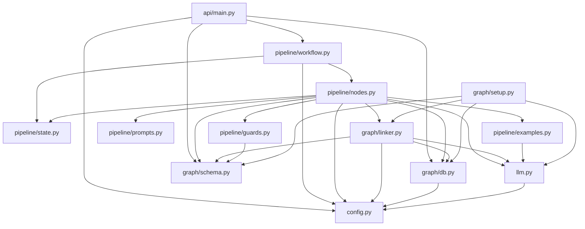
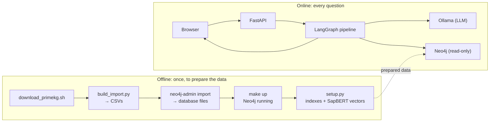
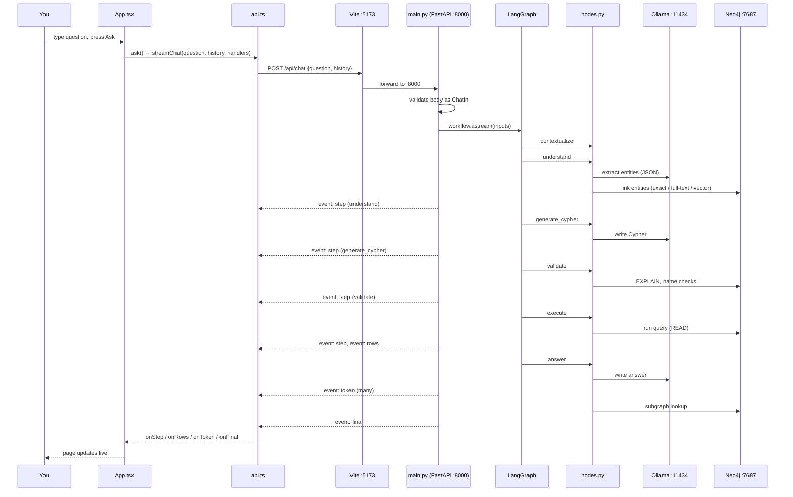
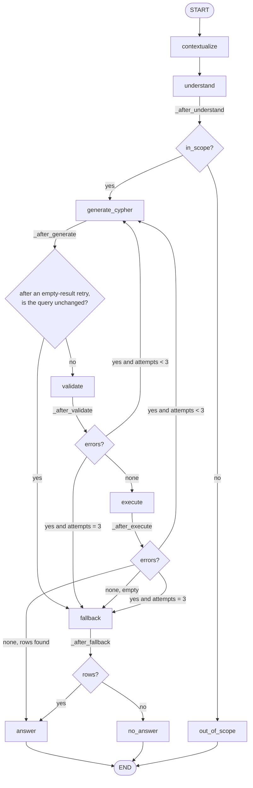
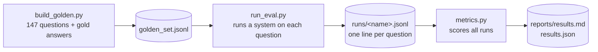
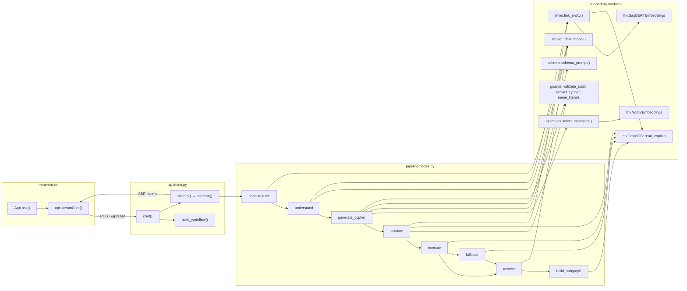

# Code flow, explained from scratch

This document explains **how MediGraph's code runs**: where it starts, in what order things happen,
which function calls which, and how data moves between files, from the moment you type a question to
the moment the answer appears.

It's written for someone new to this kind of code, so **Part A first explains the programming ideas
you need** (what an entry point is, what importing does, what a request is, how async code works).
Then Parts B onward trace the real code, using the exact file and function names, so you can follow
along with the source open.

**How to read it:** read Part A once. Then read Part D (one question, start to finish) with the code
open side by side. Use the other parts as reference.

---

## Contents

**Part A. Basics you need first**
- [A1. Programs, processes and entry points](#a1-programs-processes-and-entry-points)
- [A2. Python modules, packages and imports](#a2-python-modules-packages-and-imports)
- [A3. Functions, the call stack, and return values](#a3-functions-the-call-stack-and-return-values)
- [A4. Classes, objects and dataclasses](#a4-classes-objects-and-dataclasses)
- [A5. Decorators: `@lru_cache`, `@app.post`](#a5-decorators-lru_cache-apppost)
- [A6. Generators, `yield`, and async code](#a6-generators-yield-and-async-code)
- [A7. HTTP, ports, localhost and JSON](#a7-http-ports-localhost-and-json)
- [A8. Servers: Uvicorn, ASGI and FastAPI](#a8-servers-uvicorn-asgi-and-fastapi)
- [A9. How the browser side works: React](#a9-how-the-browser-side-works-react)
- [A10. Talking to Neo4j: driver, session, transaction](#a10-talking-to-neo4j-driver-session-transaction)
- [A11. Talking to the LLM: an HTTP call to Ollama](#a11-talking-to-the-llm-an-http-call-to-ollama)
- [A12. State machines (LangGraph)](#a12-state-machines-langgraph)

**Part B. The map**
- [B1. Every file and its job](#b1-every-file-and-its-job)
- [B2. Which file imports which](#b2-which-file-imports-which)
- [B3. Two lifecycles: offline setup and online questions](#b3-two-lifecycles-offline-setup-and-online-questions)

**Part C. Entry points and offline flows**
- [C1. All entry points](#c1-all-entry-points)
- [C2. Building the import CSVs](#c2-building-the-import-csvs-build_importpy)
- [C3. Bulk import](#c3-bulk-import-make-import)
- [C4. Indexes and embeddings](#c4-indexes-and-embeddings-setuppy)

**Part D. One question, start to finish**
- [D1. Starting the server](#d1-starting-the-server)
- [D2. The journey of one question (overview)](#d2-the-journey-of-one-question-overview)
- [D3. Browser → server](#d3-browser--server)
- [D4. Server → pipeline](#d4-server--pipeline)
- [D5. Inside the pipeline, node by node](#d5-inside-the-pipeline-node-by-node)
- [D6. How the next step is chosen (routing)](#d6-how-the-next-step-is-chosen-routing)
- [D7. The shared state: who writes what](#d7-the-shared-state-who-writes-what)
- [D8. Pipeline → browser: the event stream](#d8-pipeline--browser-the-event-stream)
- [D9. Browser: from events to pixels](#d9-browser-from-events-to-pixels)
- [D10. A worked trace with the state after every step](#d10-a-worked-trace-with-the-state-after-every-step)
- [D11. What a retry looks like](#d11-what-a-retry-looks-like)
- [D12. A snapshot of the call stack](#d12-a-snapshot-of-the-call-stack)

**Part E. Evaluation, tests, configuration, errors**
- [E1. Evaluation flow](#e1-evaluation-flow)
- [E2. Tests](#e2-tests)
- [E3. Configuration](#e3-configuration)
- [E4. Objects created once (caching)](#e4-objects-created-once-caching)
- [E5. Where errors are caught](#e5-where-errors-are-caught)
- [E6. Full call graph](#e6-full-call-graph)
- [E7. Trace it yourself](#e7-trace-it-yourself)

---

# Part A. Basics you need first

## A1. Programs, processes and entry points

A **program** is code on disk. When you run it, the operating system starts a **process**: a running
instance with its own memory. MediGraph, when fully running, is **five separate processes** that talk
to each other:

| Process | Started by | Listens on |
|---|---|---|
| Neo4j (inside Docker) | `make up` | ports 7474 (browser UI), 7687 (database protocol) |
| Ollama (LLM server) | the Ollama app | port 11434 |
| The Python API server (Uvicorn) | `make api` | port 8000 |
| The frontend dev server (Vite) | `make ui` | port 5173 |
| Your web browser | you | (it connects to 5173) |

An **entry point** is where execution starts when you run something. For a Python script it's the top
of the file, and conventionally the code in:

```python
if __name__ == "__main__":
    main()
```

`__name__` is a variable Python sets. When you run a file directly (`python build_import.py`), it's
`"__main__"`, so `main()` runs. When the file is imported by another file, it's the module's name, so
`main()` doesn't run. That lets a file be both a runnable script and an importable module.

For the API server there's no `main()`. **Uvicorn** is the entry point: it imports
`app.api.main` and looks for the object named `app` (that's what `app.api.main:app` means).

## A2. Python modules, packages and imports

- A **module** is one `.py` file. `backend/app/config.py` is the module `app.config`.
- A **package** is a folder of modules with an `__init__.py` file. `backend/app/` is the package
  `app`; `backend/app/pipeline/` is `app.pipeline`.
- `from app.config import get_settings` means: find the module `app.config`, run it if it hasn't run
  yet, and give me its `get_settings`.

**What happens when you import a module:** Python runs the file from top to bottom, once. Everything at
the top level executes: imports, `def` statements (which *define* functions without running them),
class definitions, and any plain statements like `app = FastAPI()`. The result is cached in
`sys.modules`; importing it again elsewhere reuses it without re-running.

**Where Python looks for `app`:** in the folders listed in `sys.path`. MediGraph's code lives in
`backend/app/`, so `backend/` must be on that list. That's why every way of running the code adds it:

| How the code is run | How `backend/` gets on the path |
|---|---|
| `make api` | `uvicorn ... --app-dir backend` |
| `make setup` | `cd backend && python -m app.graph.setup` (`-m` runs a module by its import name) |
| `make test` | `pythonpath = ["backend"]` in `pyproject.toml` |
| eval scripts | `sys.path.insert(0, str(ROOT / "backend"))` at the top of each script |

**Lazy imports:** some imports are inside functions, e.g. `from langchain_ollama import ChatOllama`
inside `get_chat_model()`. They only run when the function is first called, which keeps startup fast
and avoids loading heavy libraries (like PyTorch for SapBERT) unless needed.

## A3. Functions, the call stack, and return values

A **function call** pauses the current function, runs the called one, and resumes when it returns a
value. Python keeps a **call stack**: a list of the functions currently in progress, newest on top.

```python
def a(): return b() + 1     # a calls b
def b(): return c() * 2     # b calls c
def c(): return 5
a()   # stack grows: a → b → c; c returns 5, b returns 10, a returns 11
```

When something goes wrong, Python prints a **traceback**: the call stack at the moment of the error,
which tells you exactly which chain of calls led there. Reading "what calls what" in this document is
reading the call stack you'd see in a traceback.

**Return values** are how data flows back. In MediGraph's pipeline, every step function returns a
dictionary of the fields it changed, e.g. `{"cypher": "...", "attempts": 1}`.

## A4. Classes, objects and dataclasses

A **class** is a blueprint; an **object** (instance) is a thing built from it, with its own data
(attributes) and functions (methods).

```python
class GraphDB:                                   # backend/app/graph/db.py
    def __init__(self, uri, user, password):     # runs when the object is created
        self.driver = neo4j.GraphDatabase.driver(uri, auth=(user, password))
    def read(self, cypher, params=None): ...     # a method

db = GraphDB("bolt://localhost:7687", "neo4j", "your-password")   # create an object
db.read("MATCH (n) RETURN count(n)")                               # call a method
```

A **dataclass** is a class that mainly holds data; Python writes the boilerplate for you:

```python
@dataclass
class LinkedEntity:          # backend/app/graph/linker.py
    mention: str
    label: str
    name: str
    node_index: int
    score: float
    method: str
```

A **Pydantic model** (`class ChatIn(BaseModel)`) is similar, but also *validates* data: if a field has
the wrong type or breaks a rule (e.g. a question over 1,000 characters), it raises an error.

A **TypedDict** (`class GraphRAGState(TypedDict)`) is just a description of what keys a dictionary
has; it's used for type checking and doesn't validate at run time.

## A5. Decorators: `@lru_cache`, `@app.post`

A **decorator** is a line starting with `@` above a function. It wraps or registers the function.

- **`@lru_cache`** remembers the function's result. The first call runs the function; later calls
  with the same arguments return the stored result instantly. MediGraph uses it to create **one**
  shared object for expensive things:

```python
@lru_cache
def get_db() -> GraphDB:
    s = get_settings()
    return GraphDB(s.neo4j_uri, s.neo4j_user, s.neo4j_password)   # runs only on the first call

get_db() is get_db()   # True: the same object every time
```

- **`@app.post("/api/chat")`** registers the function with FastAPI: "when a POST request arrives for
  `/api/chat`, call this function".

## A6. Generators, `yield`, and async code

A **generator** is a function that produces values one at a time with `yield`, pausing between them:

```python
def count():
    yield 1      # hand out 1, pause here
    yield 2      # resume, hand out 2, pause
for x in count(): print(x)
```

MediGraph's API uses this to send events to the browser one by one as the pipeline makes progress.

**Async code.** Some operations mostly *wait* (for the LLM, the database, the network). In **async**
Python, a function declared with `async def` can `await` something slow, and while it waits, the
program can work on other tasks (like another user's request). An `async def` function containing
`yield` is an **async generator**; you consume it with `async for`.

```python
async def stream():                          # backend/app/api/main.py (simplified)
    async for mode, chunk in workflow.astream(...):   # wait for each pipeline update
        yield {"event": "step", "data": ...}           # hand it to the server to send
```

The pipeline's step functions themselves are ordinary (not async). LangGraph runs them in a worker
thread so they don't block the server.

## A7. HTTP, ports, localhost and JSON

- **HTTP** is the protocol browsers and servers use. A **request** has a method (`GET` to fetch,
  `POST` to send data), a path (`/api/chat`), headers and an optional body. The **response** has a
  status code (`200 OK`, `422 Unprocessable`, `500 Server Error`), headers and a body.
- **localhost** (`127.0.0.1`) means "this same computer". A **port** is a numbered door on a computer;
  each server listens on its own port, which is how five processes on one laptop don't collide.
- **JSON** is a text format for data: `{"question": "What drugs treat gout?", "history": []}`. Python
  dicts and lists convert to and from JSON with `json.dumps` / `json.loads`.

A request from the browser to MediGraph:

```
POST http://localhost:5173/api/chat
Content-Type: application/json

{"question": "What drugs treat gout?", "history": []}
```

## A8. Servers: Uvicorn, ASGI and FastAPI

- **Uvicorn** is the program that actually listens on port 8000, accepts network connections and
  parses HTTP. It doesn't know about your app's logic.
- **ASGI** is the standard interface between a server like Uvicorn and a Python web app. Uvicorn
  receives a request and hands it to the app object through ASGI.
- **FastAPI** is the app framework. It looks at the request's method and path, finds the function you
  registered (`@app.post("/api/chat")`), converts the JSON body into a Pydantic object (validating it),
  calls your function, and converts what it returns into a response.

```
network → Uvicorn (port 8000) → ASGI → FastAPI routing + validation → chat(body) → response
```

## A9. How the browser side works: React

- The browser loads `frontend/index.html`, which loads `src/main.tsx`.
- **React** builds the page from **components**: functions that return a description of what to show
  (JSX, the HTML-like syntax in `.tsx` files).
- Components hold **state** with `useState`. When state changes (e.g. a new piece of the answer
  arrives), React calls the component function again and updates only the parts of the page that changed.
  This is called **re-rendering**.
- `useEffect` runs code after rendering, e.g. fetching example questions when the page first loads.
- In development, **Vite** serves the files on port 5173 and **proxies** any request starting with
  `/api` to port 8000. To the browser it looks like one website.

## A10. Talking to Neo4j: driver, session, transaction

- The **driver** (`neo4j` Python package) manages network connections to Neo4j using its **Bolt**
  protocol on port 7687. It keeps a **pool** of open connections to reuse.
- A **session** is a short-lived unit of work borrowed from the driver. It can be opened in **READ** or
  **WRITE** access mode; in READ mode the server refuses writes.
- Each query runs in a **transaction**: it either completes fully or not at all, and it can have a
  **timeout**.
- `session.run(query, params)` sends the query; you then iterate over the returned **records** (rows).

```python
with driver.session(default_access_mode=neo4j.READ_ACCESS) as session:   # borrow a session
    result = session.run(neo4j.Query(cypher, timeout=10), params)          # send the query
    for record in result:                                                  # read rows
        ...
# leaving the "with" block returns the connection to the pool
```

## A11. Talking to the LLM: an HTTP call to Ollama

Ollama is just another server (port 11434). LangChain's `ChatOllama` turns your messages into an HTTP
request to Ollama's chat endpoint with the model name and settings (temperature, context size), waits
for the generated text, and returns it as a message object whose `.content` is the text. Nothing
"magic" happens in Python; the heavy computation happens in the Ollama process on the GPU.

## A12. State machines (LangGraph)

A **state machine** is a set of steps (**nodes**) with rules (**edges**) for moving between them,
plus a shared memory (**state**). At any moment the machine is "at" one node. It runs that node, the
node updates the state, and an edge rule picks the next node based on the new state.

LangGraph implements this:

- `StateGraph(GraphRAGState)` creates a machine whose state has the keys described by `GraphRAGState`.
- `add_node("validate", nodes.validate)` adds a step.
- `add_edge("contextualize", "understand")` adds a fixed rule: always go there next.
- `add_conditional_edges("validate", _after_validate, [...])` adds a rule that calls a function to
  decide.
- `compile()` checks the graph and produces a runnable object with `invoke` (run to the end) and
  `astream` (run and report progress).

Each node returns only the keys it changed; LangGraph **merges** that into the state. Most keys are
overwritten; keys declared with a **reducer** like `operator.add` are combined (a list is extended
instead of replaced).

---

# Part B. The map

## B1. Every file and its job

```
medigraph_llm_rag/
├── Makefile                     short names for commands (make up, make api, ...)
├── docker-compose.yml           how to run Neo4j in Docker
├── pyproject.toml, uv.lock      Python dependencies (exact versions), pytest and ruff settings
├── .env / .env.example          settings: model, database password, limits (read by config.py)
├── data/
│   ├── scripts/download_primekg.sh    download PrimeKG's files from Harvard Dataverse
│   ├── scripts/build_import.py        convert them into CSVs Neo4j can bulk-load
│   ├── raw/                           the downloaded files (not in git)
│   └── import/                        the generated CSVs (not in git)
├── backend/app/                 the Python package "app"
│   ├── config.py                Settings (from .env) and get_settings()
│   ├── llm.py                   get_chat_model() for Qwen/OpenAI; NomicEmbeddings; SapBERTEmbeddings
│   ├── graph/
│   │   ├── db.py                GraphDB: read() (safe queries), explain(), write() (setup only); get_db()
│   │   ├── schema.py            the graph's labels and relationships; schema_prompt() for the LLM
│   │   ├── linker.py            link_entity(): turn "heart attack" into a graph node
│   │   └── setup.py             one-off: create indexes, compute and store SapBERT vectors
│   ├── pipeline/
│   │   ├── state.py             GraphRAGState: the keys of the shared state
│   │   ├── workflow.py          build_workflow(): the state machine; routing functions; run()
│   │   ├── nodes.py             the 9 step functions (contextualize ... answer)
│   │   ├── prompts.py           the text templates sent to the LLM
│   │   ├── guards.py            checks on generated Cypher (read-only, schema, names)
│   │   └── examples.py          22 example queries; select_examples() picks the closest 4
│   └── api/main.py              FastAPI app: /api/health, /api/schema, /api/examples, /api/chat
├── backend/tests/test_guards.py 22 unit tests for guards.py
├── frontend/
│   ├── index.html               the page shell; loads src/main.tsx
│   ├── vite.config.ts           dev server; forwards /api to port 8000
│   └── src/
│       ├── main.tsx             starts React, renders <App />
│       ├── App.tsx              the chat and the evidence panel
│       ├── api.ts               streamChat(): sends the question, reads the event stream
│       └── GraphView.tsx        draws the subgraph
├── eval/
│   ├── build_golden.py          creates the 147 test questions with correct answers
│   ├── run_eval.py              runs a system over the questions, saves every result
│   ├── metrics.py               scores the saved results, writes reports/results.md
│   ├── link_eval.py             entity-linking benchmark (SapBERT vs nomic)
│   └── run_all.sh               runs several evaluations one after another
└── docs/                        decision.md, flow.md, screenshots
```

## B2. Which file imports which

An arrow `A → B` means "A imports B". Following the arrows shows what loads when.



Notice `config.py` is at the bottom of everything: almost every module reads settings. And
`schema.py` imports nothing from the project: it's plain data, shared by the prompt (`schema_prompt`)
and the validator (`guards.py`).

## B3. Two lifecycles: offline setup and online questions



- **Offline** steps write to the database and are run once (or when the data changes).
- **Online** steps only ever read the database. This separation is a safety property: the code that
  handles user questions never calls `GraphDB.write`.

---

# Part C. Entry points and offline flows

## C1. All entry points

| You run | What starts | First code that runs |
|---|---|---|
| `make install` | `uv sync` and `npm install` | (installs packages; no project code) |
| `make data` | `download_primekg.sh`, then `build_import.py` | `fetch()` in the shell script, then `build_import.main()` |
| `make import` | `neo4j-admin database import` inside the Neo4j image | Neo4j's tool (no Python) |
| `make up` | `docker compose up -d --wait` | Neo4j server; returns when its healthcheck passes |
| `make setup` | `python -m app.graph.setup` from `backend/` | `setup.main()` |
| `make api` | `uvicorn app.api.main:app --app-dir backend --port 8000` | imports `app/api/main.py` (D1), then `chat()` per question |
| `make ui` | `npm run dev` (Vite) | browser loads `index.html` → `src/main.tsx` |
| `make test` | `pytest` | each `test_*` function in `backend/tests/test_guards.py` |
| `uv run python eval/build_golden.py` | test set builder | `build_golden.main()` |
| `uv run python eval/run_eval.py ...` | evaluation runner | `run_eval.main()` |
| `uv run python eval/metrics.py` | scoring | `metrics.main()` |
| `uv run python eval/link_eval.py` | linking benchmark | `link_eval.main()` |
| `eval/run_all.sh` | several runs in sequence | its `run()` shell function |

Setting up from nothing, in order: `make install` → `make data` → `make import` → `make up` →
`make setup` → `make api` and `make ui` (in two terminals).

## C2. Building the import CSVs (`build_import.py`)

**Purpose:** turn PrimeKG's raw files into two CSV files in exactly the format Neo4j's bulk importer
expects, cleaning the data on the way (decision D6).

**Input:** `data/raw/nodes.tab`, `edges.csv`, `drug_features.tab`, `disease_features.tab`.
**Output:** `data/import/nodes.csv`, `data/import/relationships.csv`.

```
main()
│
├── OUT.mkdir(...)                         make sure data/import/ exists
│
├── nodes = build_nodes()
│   ├── pd.read_csv("raw/nodes.tab", sep="\t")
│   │      a table: node_index, node_id, node_type, node_name, node_source  (129,375 rows)
│   ├── check every node_type is a key of LABELS  → stop with an error if a new type appears
│   ├── nodes["label"] = node_type mapped through LABELS   ("gene/protein" → "Gene")
│   ├── drugs = pd.read_csv("raw/drug_features.tab")
│   │      first_non_empty(drugs, ["description"]) and ["mechanism_of_action"]
│   │      → each calls clean_text(): fill blanks, collapse whitespace, cut to 700 characters
│   ├── diseases = pd.read_csv("raw/disease_features.tab")
│   │      description from mondo_definition / umls_description / orphanet_definition (first non-empty)
│   │      symptoms   from mayo_symptoms / orphanet_clinical_description
│   └── nodes.join(text, on="node_index")   attach the text columns to the matching nodes
│
├── edges = build_edges(nodes)
│   ├── pd.read_csv("raw/edges.csv")       relation, display_relation, x_index, y_index (8,100,498 rows)
│   ├── rel_type = relation mapped through RELATIONS            ("indication" → "INDICATED_FOR")
│   ├── for drug_protein rows: display_relation through DRUG_PROTEIN  ("target" → "TARGETS")
│   ├── stop with an error if any relation is unmapped
│   ├── rank = each node's label → RANK                          (Drug 0, Disease 1, ..., Gene 9)
│   ├── swap = rank(x) > rank(y), or same rank and x_index > y_index
│   ├── src, dst = x, y with swapped rows reversed
│   └── DataFrame(:START_ID, :END_ID, :TYPE).drop_duplicates()  (→ 4,050,249 rows)
│
├── write nodes.csv           columns: node_index:ID, name, source_id, source,
│                                      description, mechanism, symptoms, :LABEL
├── write relationships.csv   columns: :START_ID, :END_ID, :TYPE
└── print node counts per label and edge counts per type
```

The column names with colons (`:ID`, `:LABEL`, `:START_ID`, `:END_ID`, `:TYPE`) are instructions for
Neo4j's importer: which column is the node's ID, which is its label, and so on.

## C3. Bulk import (`make import`)

**Purpose:** create the Neo4j database files from the CSVs in one fast step (decision D7).

```
docker compose down                                       stop Neo4j (the importer needs it stopped)
docker compose run --rm --no-deps neo4j \                 start a temporary Neo4j container
    neo4j-admin database import full neo4j \              run the importer inside it
    --overwrite-destination --id-type=integer \
    --nodes=/import/nodes.csv --relationships=/import/relationships.csv
```

`docker-compose.yml` mounts your `data/import/` folder at `/import` inside the container and keeps the
database in the `neo4j_data` volume, so the result persists. Then `make up` starts the real server.

## C4. Indexes and embeddings (`setup.py`)

**Purpose:** prepare everything entity linking needs (decisions D10, D11, D18): name indexes, a
full-text index, and SapBERT vectors with vector indexes. This is the **only** code that writes to the
database after the import.

```
main()
├── read options: --skip-embeddings, --embedder sapbert|nomic|both (default sapbert)
│
├── create_indexes()
│   ├── db = get_db()                                 first call creates the GraphDB (cached)
│   ├── for each of the 10 labels:
│   │   ├── db.write("CREATE INDEX disease_name IF NOT EXISTS FOR (n:Disease) ON (n.name)")
│   │   └── db.write("CREATE INDEX disease_idx  IF NOT EXISTS FOR (n:Disease) ON (n.node_index)")
│   ├── db.write("CREATE FULLTEXT INDEX entity_names IF NOT EXISTS
│   │             FOR (n:Disease|Drug|Phenotype|Gene|Exposure|Anatomy|Pathway) ON EACH [n.name]")
│   └── db.write("CALL db.awaitIndexes(300)")         wait until all indexes are built
│
└── embed_names("sapbert")
    ├── emb = get_entity_embeddings("sapbert")        loads SapBERT from Hugging Face onto the Mac GPU
    ├── prop = "sapbert"
    ├── dimensions = len(emb.embed_query("test"))     → 768
    └── for each label in Disease, Drug, Phenotype, Exposure, Anatomy, Gene, Pathway:
        ├── todo = db.read("MATCH (n:Disease) WHERE n.sapbert IS NULL RETURN idx, name")
        │        (only nodes not yet embedded, so the script can resume after a crash)
        ├── for each batch of 64 names:
        │   ├── vectors = _embed_with_retry(emb, names)
        │   │       └── emb.embed_documents(names); on error wait and retry, up to 4 times
        │   └── db.write("UNWIND $rows AS row
        │                 MATCH (n:Disease {node_index: row.idx})
        │                 CALL db.create.setNodeVectorProperty(n, 'sapbert', row.vec)")
        └── db.write("CREATE VECTOR INDEX sapbert_disease ... vector.dimensions 768, cosine")
    └── db.write("CALL db.awaitIndexes(600)")
```

**`UNWIND`** turns a list into rows, so one query stores 64 vectors at once (much faster than 64
separate queries). **`setNodeVectorProperty`** stores the list of numbers in the compact format the
vector index expects.

---

# Part D. One question, start to finish

## D1. Starting the server

`make api` runs `uvicorn app.api.main:app --app-dir backend --port 8000`. Here's exactly what happens.

**1. Uvicorn starts** and adds `backend/` to Python's import path (`--app-dir backend`).

**2. Uvicorn imports `app.api.main`.** Python runs `backend/app/api/main.py` top to bottom. Its imports
pull in the rest of the backend, each module running once:

```
app/api/main.py
├── import fastapi, pydantic, sse_starlette          (libraries)
├── from app.config import get_settings              → runs config.py: defines Settings, get_settings
│                                                        (nothing is read from .env yet)
├── from app.graph.db import get_db                  → runs db.py: defines GraphDB, get_db
│                                                        (no database connection yet)
├── from app.graph.schema import ...                 → runs schema.py: builds the label and
│                                                        relationship tables (plain data)
└── from app.pipeline.workflow import build_workflow → runs workflow.py, which imports:
    ├── app.pipeline.nodes                           → runs nodes.py, which imports:
    │   ├── app.graph.linker                         (defines link_entity; imports llm.py)
    │   ├── app.llm                                  (defines model factories; loads no model)
    │   ├── app.pipeline.prompts                     (text templates)
    │   ├── app.pipeline.examples                    (the 22 examples; vectors not computed yet)
    │   ├── app.pipeline.guards                      (compiles the regular expressions)
    │   └── app.pipeline.state                       (GraphRAGState)
    └── defines build_workflow() and the routing functions (the graph isn't built yet)
```

**3. The rest of `main.py` runs:**

```python
app = FastAPI(title="MediGraph", version="0.1.0")        # the app object Uvicorn was looking for
app.add_middleware(CORSMiddleware, allow_origins=["http://localhost:5173", ...])
# then each @app.get / @app.post decorator registers its function:
#   GET /api/health → health()     GET /api/schema → schema()
#   GET /api/examples → examples() POST /api/chat → chat()
```

**CORS middleware** tells browsers that pages served from `localhost:5173` are allowed to call this
API. Browsers block cross-site calls unless the server explicitly allows them.

**4. Uvicorn finds `app`** and starts listening on port 8000.

**Nothing expensive has happened yet.** No database connection, no SapBERT, no compiled graph. All of
those are created the first time they're needed and then reused (E4). That's why the **first**
question is a few seconds slower than the rest.

## D2. The journey of one question (overview)



The next sections zoom into each hop.

## D3. Browser → server

**File:** `frontend/src/App.tsx`, function `ask(question)`; `frontend/src/api.ts`, function `streamChat`.

1. You type a question and press **Ask** (or click an example). The form's submit handler calls
   `ask(input)`.
2. `ask()`:
   - returns early if the question is empty or a request is already running (`busy`);
   - builds `history` from earlier messages, leaving out ones still pending or with errors;
   - appends two messages to state: your question, and an empty **pending** assistant message with an
     empty evidence object (`emptyEvidence()`);
   - sets `busy = true` and switches the panel to the Pipeline tab;
   - calls `await streamChat(question, history, handlers)`, passing five handler functions
     (`onStep`, `onRows`, `onToken`, `onFinal`, `onError`) that each update the pending message.
3. `streamChat()` sends:

```
POST /api/chat
Content-Type: application/json

{"question": "What drugs treat a heart attack?", "history": []}
```

4. The browser sends it to Vite (port 5173), and Vite's proxy forwards it to `http://localhost:8000`
   (configured in `frontend/vite.config.ts`).

## D4. Server → pipeline

**File:** `backend/app/api/main.py`, function `chat(body)` and its inner `stream()`.

1. **Uvicorn** receives the request and passes it to FastAPI.
2. **FastAPI** matches `POST /api/chat` to `chat()`, and converts the JSON body into a `ChatIn`
   object. If it doesn't fit (missing `question`, over 1,000 characters, more than 20 history turns, a
   role other than `user`/`assistant`), FastAPI replies `422` and `chat()` never runs.
3. **`chat(body)`** runs:

```python
if not body.question.strip():
    raise HTTPException(400, "Empty question")            # whitespace-only question
workflow = build_workflow()                                # first call compiles the graph; later calls reuse it
inputs = {"question": body.question,
          "history": [t.model_dump() for t in body.history]}   # Pydantic objects → plain dicts
return EventSourceResponse(stream())                       # start streaming the response
```

4. **`EventSourceResponse`** (from the `sse-starlette` package) keeps the HTTP response open and sends
   each value that `stream()` yields as a server-sent event.
5. **`stream()`** starts the pipeline:

```python
async for mode, chunk in workflow.astream(
        inputs, {"recursion_limit": 30}, stream_mode=["updates", "messages"]):
    ...   # turn each piece of progress into an event (D8)
```

`astream` runs the state machine and yields two kinds of progress: **"updates"** (a node finished;
here is what it returned) and **"messages"** (the LLM produced a piece of text).

## D5. Inside the pipeline, node by node

All node functions are in `backend/app/pipeline/nodes.py`. Each one:

- receives `state` (the shared dictionary) and, for nodes that call the LLM, `config` (run settings);
- does its job;
- returns a **dictionary of only the keys it changed**, which LangGraph merges into the state.

Two helpers used throughout:

```python
def _llm(config, fast=False):
    # Reads optional overrides from config["configurable"] (the evaluation uses these to swap models).
    # With fast=True it could use a smaller model for easy steps, but that setting is empty by default.
    return get_chat_model(provider, model)        # → ChatOllama(model="qwen3.5:9b", temperature=0, ...)

def _trace(step, start, **detail):
    # One record for the UI and the evaluation: step name, milliseconds taken, extra details.
    return [{"step": step, "ms": elapsed_ms, **detail}]
```

`get_chat_model()` (in `llm.py`) creates a lightweight `ChatOllama` client each time; the model itself
stays loaded inside Ollama.

---

### Node 1: `contextualize(state, config)`

**Job:** turn a follow-up ("Which of those cause nausea?") into a standalone question.

**Reads:** `question`, `history`. **Writes:** `standalone_question`, `trace`.

```
if history is empty:
    return {standalone_question: question}                 # first question: nothing to rewrite, no LLM call
convo  = last 6 turns, each cut to 800 characters, as "role: content" lines
prompt = prompts.CONTEXTUALIZE.format(history=convo, question=question)
reply  = _llm(config, fast=True).invoke(prompt)            # HTTP call to Ollama
q      = reply.content, stripped of whitespace and quotes (or the original if empty)
return {standalone_question: q, trace}
```

**Why first:** every later step works from `standalone_question`, so none of them needs the history.

---

### Node 2: `understand(state, config)`

**Job:** find the medical entities in the question, match each to a real graph node, and decide
whether the question is in scope.

**Reads:** `standalone_question`. **Writes:** `entities`, `in_scope`, `scope_reason`, `trace`.

**Step 2a: ask the LLM for structured data.**

```python
extractor = _llm(config, fast=True).with_structured_output(Extraction)
parsed = extractor.invoke(prompts.EXTRACT.format(question=question))
```

`with_structured_output(Extraction)` converts the Pydantic class `Extraction` into a JSON schema and
asks Ollama to produce output matching it exactly. The result is an `Extraction` object, e.g.:

```python
Extraction(entities=[Mention(mention="heart attack", canonical="myocardial infarction", type="Disease")],
           in_scope=True, reason="")
```

If anything fails, the code continues with `Extraction(entities=[], in_scope=True)`, so the request
doesn't crash.

**Step 2b: link each mention** (up to 10):

```
db = get_db()                                          # the shared Neo4j client
for m in parsed.entities[:10]:
    label = m.type if it's a real label else None
    own = link_entity(db, m.mention, label)            # try the user's exact words first
    if own and own[0].method == "exact":
        candidates = own                               # user's words name a real node: trust them
    else:
        candidates = own (+ link_entity(db, m.canonical, label) if canonical differs)
    if not candidates and label:
        candidates = link_entity(db, m.canonical, None)    # maybe the LLM guessed the type wrong
    if not candidates: skip this mention
    sort candidates: exact matches first, then by score
    best = candidates[0]; alternatives = next 2 different names
    linked.append({...best, mention, alternatives})
return {entities: linked, in_scope: parsed.in_scope, scope_reason: parsed.reason, trace}
```

**Inside `link_entity(db, mention, label)`** (`backend/app/graph/linker.py`):

```
k = settings.entity_candidates                         # 3
if label isn't linkable: label = None                   # search all linkable labels

# 1. Exact match, trying the casings PrimeKG uses
variants = [mention, mention.lower(), mention.capitalize(), mention.upper()]
rows = db.read(one MATCH per label, joined with UNION:
               "MATCH (n:Disease) WHERE n.name IN $names RETURN n.name, n.node_index, 'Disease'")
if rows: return them as LinkedEntity(score=1.0, method="exact")        ← most questions stop here

# 2. Gather candidates
emb = get_entity_embeddings()                          # SapBERT, loaded once and cached
vector = emb.embed_query(mention)                      # 768 numbers, computed on the Mac GPU
fulltext_candidates(db, mention, label, k)
    escape Lucene special characters
    query = '"heart attack"^3 OR (heart~1 AND attack~1)'
    db.read("CALL db.index.fulltext.queryNodes('entity_names', $query) YIELD node, score ...")
vector_candidates(db, mention, vector, label, k)
    for each embedded label (or only `label`):
        db.read("CALL db.index.vector.queryNodes('sapbert_disease', $k, $vector) YIELD node, score ...")
        (if that index doesn't exist yet: skip it)
merge candidates by node_index (found by both → method "fulltext+vector")

# 3. Re-score every candidate on one scale
name_vectors = emb.embed_documents([each candidate's name])
for each candidate:
    semantic = cosine(vector, name_vector)
    lexical  = SequenceMatcher(None, mention.lower(), name.lower()).ratio()
    score    = 0.85 × semantic + 0.15 × lexical

# 4. Keep good ones
keep score ≥ MIN_SCORE["sapbert"] (0.55); sort by score; return the top 3
```

**Why this order:** exact is instant and certain; the other two searches cover typos and synonyms; the
re-scoring puts them on one scale; the threshold avoids confidently wrong matches.

---

### Node 3: `generate_cypher(state, config)`

**Job:** have the LLM write a Cypher query.

**Reads:** `standalone_question`, `entities`, and on retries `cypher` and `errors`.
**Writes:** `cypher`, `attempts` (+1), `errors` (cleared), `trace`.

**Step 3a: choose 4 examples** with `select_examples(question)` (`examples.py`):

```
q = get_embeddings().embed_query(question)       # nomic, via Ollama
q = q / its length                               # normalise
scores = _example_vectors() @ q                  # cosine similarity with all 22 examples
                                                 # (_example_vectors embeds the 22 once, then is cached)
return the 4 highest-scoring (question, cypher) pairs
```

**Step 3b: build the prompt.**

```python
system = prompts.TEXT2CYPHER.format(
    schema=schema_prompt(),                       # labels and relationships, rendered from schema.py
    entities=_entities_block(state["entities"]),  # '- "heart attack" -> (:Disease {name: "myocardial infarction"})'
    examples="\n\n".join(f"Question: {q}\nCypher:\n{c}" for q, c in examples))
messages = [SystemMessage(system), HumanMessage(f"Question: {question}\nCypher:")]
```

**Step 3c: on a retry, show the model its mistake.** If the state has both `errors` and a previous
`cypher`:

```python
messages += [AIMessage(state["cypher"]),                         # "you wrote this"
             HumanMessage(prompts.TEXT2CYPHER_RETRY.format(       # "it failed because ... fix it"
                 cypher=state["cypher"], errors="\n".join(state["errors"])))]
```

**Step 3d: call the model and clean the reply.**

```python
reply = _llm(config).invoke(messages)            # Qwen3.5-9B via Ollama
cypher = extract_cypher(str(reply.content))      # guards.py: take the ```cypher block if present,
                                                 # remove a leading "Cypher:", remove a trailing ";"
return {"cypher": cypher, "attempts": attempts + 1, "errors": [], "trace": ...}
```

`errors` is cleared so the next routing decision only sees errors from *this* attempt.

---

### Node 4: `validate(state)`

**Job:** check the query before it runs; produce precise error messages if it's wrong.

**Reads:** `cypher`, `attempts`. **Writes:** `errors`, `attempt_log` (appended), `trace`.

```
errors = validate_static(cypher)                          # guards.py, no database needed
    if empty                → ["The model returned an empty query."]
    if no RETURN            → ["The query must end with a RETURN clause."]
    check_read_only(cypher)
        _strip_strings(): replace every quoted string with '' (so words inside names don't count)
        ";" anywhere        → error ("Only a single statement is allowed")
        WRITE_CLAUSES regex → error ("Only read queries are allowed; found 'DELETE'")
    if read-only passed: check_schema(cypher)
        properties used (x.prop, {.prop}, {prop: ...}) not in ALL_PROPERTIES → error + "Did you mean ...?"
        every ":Name" (outside map literals) not a known label or relationship type → error + suggestion
        every "(:A)-[:REL]->(:B)" with both labels written, not in the schema's directions
            → error listing the valid direction(s)

if no errors:
    query_type = get_db().explain(cypher)                 # db.py: runs "EXPLAIN " + cypher in a READ session
    if query_type != "r": errors = ["Query type 'rw' is not read-only."]
    (if Neo4j raises an error, e.g. bad syntax: errors = ["Neo4j rejected the query: ..."])

if no errors:
    errors = check_entity_names(cypher)                   # nodes.py
        for (label, name) in name_literals(cypher):       # guards.py finds {name: 'X'}, x.name = 'X',
                                                          # x.name IN [...], and the label of x
            db.read("MATCH (n:Phenotype {name: $name}) RETURN 1")   (UNION over labels if unknown)
            if not found:
                suggestions = link_entity(db, name, label)          # closest real names
                errors.append("No :Phenotype node is named 'Bleeding'. Closest existing names: ...")

return {errors, attempt_log: [{attempt, cypher, errors}], trace}
```

`attempt_log` uses the append reducer, so after several attempts it holds every query and its errors.
The evaluation saves it to show how retries went.

---

### Node 5: `execute(state)`

**Job:** run the validated query safely.

**Reads:** `cypher`, `empty_retry_done`. **Writes:** `rows`, `truncated`, `trace`, and sometimes
`errors` and `empty_retry_done`.

```
try:
    result = get_db().read(cypher)
except a Neo4j error (e.g. timeout):
    return {errors: ["Execution failed: ..."], rows: [], trace}
```

**Inside `GraphDB.read(cypher)`** (`backend/app/graph/db.py`):

```python
query = neo4j.Query(cypher, timeout=10)                                  # server stops it after 10 s
with self.driver.session(default_access_mode=neo4j.READ_ACCESS) as session:   # writes refused
    result = session.run(query, params)
    for record in result:
        if len(rows) >= 50: truncated = True; break                      # row cap
        rows.append({key: _to_plain(value) for key, value in record.items()})
    result.consume()                                                     # finish and free the result
return QueryResult(rows=rows, truncated=truncated)
```

`_to_plain()` converts Neo4j's special objects (Node, Relationship, Path) into plain dictionaries and
removes the large `embedding` / `sapbert` vector properties, so they never reach the LLM or the browser.

Back in `execute()`:

```
if the rows are empty (no rows, or every value null/empty) and empty_retry_done is not set:
    add empty_retry_done = True
    add errors = ["The query ran but returned no results. Check relationship directions and that
                   the entity names match the linked entities. If the query is correct, return it unchanged."]
return {rows, truncated, trace, ...}
```

Setting `errors` here is what makes the router send the flow back for one retry (D6).

---

### Node 6: `fallback(state)`

**Job:** when no direct answer was found, gather what the graph *does* know about the entities.

**Reads:** `entities`. **Writes:** `rows`, `truncated` (False), `used_fallback` (True), `trace`.

```
for each of up to 3 linked entities (label checked against the known list,
                                     because it's written into the query text):
    rows += db.read("""
        MATCH (n:Disease {node_index: $idx})-[r]-(m)
        WITH n, type(r) AS relationship, startNode(r) = n AS outgoing, labels(m)[0] AS other_label,
             collect(DISTINCT m.name) AS names
        RETURN n.name AS entity, relationship, direction, other_label,
               size(names) AS total, names[..8] AS examples
        ORDER BY total DESC LIMIT 12""")           # e.g. "gout, HAS_PHENOTYPE, outgoing, Phenotype, 23, [...]"
    rows += the entity's description / mechanism / symptoms text, if any
return {rows, truncated: False, used_fallback: True, trace}
```

---

### Node 7: `answer(state, config)`

**Job:** write the final answer from the rows only.

**Reads:** `rows`, `used_fallback`, `standalone_question`, `cypher`, `truncated`.
**Writes:** `answer`, `status`, `subgraph`, `trace`.

```
rows   = _compact(state.rows)              # every string longer than 500 characters is shortened
prompt = prompts.ANSWER.format(
    fallback_note = prompts.FALLBACK_NOTE if used_fallback else "",   # "say the exact fact wasn't found"
    question      = standalone_question,
    cypher        = cypher (or "(neighbourhood lookup)" after a fallback),
    n_rows        = number of rows,
    truncated     = ", truncated" if the list was cut,
    rows          = json.dumps(rows)[:12000])
reply = _llm(config).invoke(prompt)        # Qwen3.5-9B; its tokens are also streamed to the browser (D8)
return {answer: reply text,
        status: "fallback" if used_fallback else "answered",
        subgraph: build_subgraph(state),
        trace}
```

---

### Nodes 8 and 9: `no_answer(state)` and `out_of_scope(state)`

No LLM call in either; the text is fixed or templated, so it can't hallucinate.

```
no_answer:     {answer: prompts.NO_ANSWER,
                status: "no_answer", subgraph: build_subgraph(state)}
out_of_scope:  {answer: "I can't answer that from the knowledge graph: <scope_reason>. I can tell you
                         which drugs are indicated ... please talk to a clinician.",
                status: "out_of_scope", subgraph: build_subgraph(state)}
```

---

### Helper: `build_subgraph(state)`

**Job:** collect the nodes mentioned in the evidence and the edges between them, for the Graph tab.

```
seeds = names of the linked entities
names = seeds + every short string (≤ 120 chars) found anywhere in the rows      (at most 120)
nodes = db.read( for every label: "MATCH (n:<label>) WHERE n.name IN $names
                                   RETURN elementId(n) AS id, n.name, label, n.name IN $seeds AS seed"
                 joined with UNION ALL )                                       (at most 60 nodes)
edges = db.read("MATCH (a)-[r]->(b) WHERE elementId(a) IN $ids AND elementId(b) IN $ids
                 RETURN source, target, type(r)")                              (at most 200 edges)
return {nodes, edges}
```

One labelled lookup per label is used because indexes only work with a label (an unlabelled
`MATCH (n) WHERE n.name IN ...` would scan all 129,375 nodes).

## D6. How the next step is chosen (routing)

After each node, LangGraph follows the edge out of it. Fixed edges always go the same way; conditional
edges call a routing function in `backend/app/pipeline/workflow.py`.



The five routing functions, in full:

```python
def _after_understand(state):
    return "generate_cypher" if state.get("in_scope", True) else "out_of_scope"

def _after_generate(state):
    log = state.get("attempt_log") or []
    if state.get("empty_retry_done") and log and log[-1]["cypher"] == state["cypher"]:
        return "fallback"                    # the model returned the same query: it stands by it
    return "validate"

def _after_validate(state):
    if not state.get("errors"):
        return "execute"
    return "generate_cypher" if state["attempts"] < max_cypher_attempts else "fallback"

def _after_execute(state):
    if not state.get("errors"):
        return "fallback" if _is_empty(state["rows"]) else "answer"
    return "generate_cypher" if state["attempts"] < max_cypher_attempts else "fallback"

def _after_fallback(state):
    return "answer" if state.get("rows") else "no_answer"
```

**How the empty-result retry works, precisely:**

1. First empty result: `execute` sets `errors` and `empty_retry_done = True`.
2. `_after_execute` sees errors and attempts left → `generate_cypher`.
3. The model gets the "returned no results" message. If it writes the **same** query,
   `_after_generate` sends the flow to `fallback` (don't run it again).
4. If it writes a different query that is also empty, `execute` does **not** set errors this time
   (the flag is already set), so `_after_execute` sees "no errors, empty rows" → `fallback`.

**Building the graph** (`build_workflow()`, run once thanks to `@lru_cache`):

```python
g = StateGraph(GraphRAGState)
for name, fn in [("contextualize", ...), ("understand", ...), ("generate_cypher", ...),
                 ("validate", ...), ("execute", ...), ("fallback", ...),
                 ("answer", ...), ("no_answer", ...), ("out_of_scope", ...)]:
    g.add_node(name, fn)
g.add_edge(START, "contextualize")
g.add_edge("contextualize", "understand")
g.add_conditional_edges("understand", _after_understand, ["generate_cypher", "out_of_scope"])
g.add_conditional_edges("generate_cypher", _after_generate, ["validate", "fallback"])
g.add_conditional_edges("validate", _after_validate, ["execute", "generate_cypher", "fallback"])
g.add_conditional_edges("execute", _after_execute, ["answer", "generate_cypher", "fallback"])
g.add_conditional_edges("fallback", _after_fallback, ["answer", "no_answer"])
for terminal in ("answer", "no_answer", "out_of_scope"):
    g.add_edge(terminal, END)
return g.compile()
```

The `recursion_limit` of 30 passed at run time stops the machine if a bug ever caused an endless
loop. Normal runs take 6–12 steps.

## D7. The shared state: who writes what

Defined in `backend/app/pipeline/state.py` as `GraphRAGState`. "Append" means the field uses the
`operator.add` reducer, so new lists are added on instead of replacing the old one.

| Field | Meaning | Written by | Read by |
|---|---|---|---|
| `question` | what the user typed | input | contextualize |
| `history` | previous turns | input | contextualize |
| `standalone_question` | the question with references resolved | contextualize | understand, generate_cypher, answer |
| `entities` | linked graph nodes, with alternatives | understand | generate_cypher, fallback, build_subgraph |
| `in_scope`, `scope_reason` | can the graph answer this? | understand | `_after_understand`, out_of_scope |
| `cypher` | the current query | generate_cypher | validate, execute, answer, `_after_generate`, retry prompt |
| `attempts` | how many queries written so far | generate_cypher (+1) | `_after_validate`, `_after_execute` |
| `errors` | problems with the current attempt | generate_cypher (clears), validate, execute | routing, retry prompt |
| `attempt_log` (append) | every query and its errors | validate | `_after_generate`, evaluation |
| `empty_retry_done` | has the one empty-result retry been used? | execute | execute, `_after_generate` |
| `rows`, `truncated` | query results; was the list cut at 50? | execute, fallback | routing, answer, build_subgraph |
| `used_fallback` | did the answer come from the fallback? | fallback | answer |
| `answer`, `status`, `subgraph` | the final output | answer / no_answer / out_of_scope | API `final` event, evaluation |
| `trace` (append) | timing and details of each step | contextualize, understand, generate_cypher, validate, execute, fallback, answer | API `step` events, evaluation |

## D8. Pipeline → browser: the event stream

Back in `stream()` in `backend/app/api/main.py`, each piece of progress becomes an event:

```python
async for mode, chunk in workflow.astream(inputs, {"recursion_limit": 30},
                                          stream_mode=["updates", "messages"]):
    if mode == "messages":                        # a piece of LLM output
        message, meta = chunk
        if meta.get("langgraph_node") == "answer" and message.content:
            yield _event("token", {"text": message.content})     # only the answer's text is shown
        continue
    for node, update in chunk.items():            # mode == "updates": {node_name: what it returned}
        if not update: continue
        if node in STEP_EVENTS:                   # contextualize, understand, generate_cypher,
            for t in update.get("trace", []):     # validate, execute, fallback
                yield _event("step", t)
            if node == "execute" and "rows" in update:
                yield _event("rows", {"rows": update["rows"][:50], "truncated": update.get("truncated")})
            if node == "fallback":
                yield _event("rows", {"rows": update["rows"], "fallback": True})
        if node in FINAL_NODES:                   # answer, no_answer, out_of_scope
            final = update
yield _event("final", {"answer": final.get("answer", ""), "status": final.get("status"),
                       "subgraph": final.get("subgraph", ...), "ms": total_milliseconds})
# any exception during all this → yield _event("error", {"message": str(exc)})
```

`_event(name, data)` returns `{"event": name, "data": json.dumps(data)}`, and `EventSourceResponse`
writes it to the network as:

```
event: step
data: {"step": "understand", "ms": 15234, "entities": [...], "in_scope": true}

```

**Why filter tokens by node:** the "messages" stream includes output from *every* LLM call, including
the JSON from `understand` and the raw Cypher from `generate_cypher`. Only the `answer` node's text is
meant for the user.

| Event | Comes from | Contains |
|---|---|---|
| `step` | each trace entry from a step node | step name, ms, and step-specific details (entities, cypher, errors, row count) |
| `rows` | `execute` or `fallback` | the rows (and `truncated` or `fallback` flags) |
| `token` | `answer` node LLM output | a piece of answer text |
| `final` | the terminal node | answer, status, subgraph, total time |
| `error` | an exception | the error message |

## D9. Browser: from events to pixels

**File:** `frontend/src/api.ts`, inside `streamChat()`.

```ts
const reader = res.body.getReader()          // read the response as it arrives
let buffer = ''
for (;;) {
  const { value, done } = await reader.read()      // wait for the next chunk of bytes
  if (done) break
  buffer += decoder.decode(value, { stream: true })
  while ((sep = buffer.indexOf('\n\n')) >= 0) {    // a blank line ends one event
    const raw = buffer.slice(0, sep); buffer = buffer.slice(sep + 2)
    // read the "event:" line and the "data:" lines, JSON.parse the data
    if (event === 'step')  h.onStep(payload)
    if (event === 'rows')  h.onRows(payload.rows, payload)
    if (event === 'token') h.onToken(payload.text)
    if (event === 'final') h.onFinal(payload)
    if (event === 'error') h.onError(payload.message)
  }
}
```

**Why a buffer:** network chunks don't line up with events. One chunk may hold half an event or three
events, so text is collected until a complete event (ending in a blank line) has arrived.

**Why not the browser's built-in `EventSource`:** it only supports GET requests, and this request needs
a POST body.

**The handlers** (defined inside `ask()` in `App.tsx`) each update the pending assistant message in
React state:

| Handler | Updates |
|---|---|
| `onStep(step)` | appends to `evidence.steps`; if the step is `generate_cypher`, sets `evidence.cypher` |
| `onRows(rows, meta)` | sets `evidence.rows`, `truncated`, `fallback` |
| `onToken(text)` | appends text to the message's `content`, so the answer appears word by word |
| `onFinal(final)` | sets the final `content`, marks it not pending, sets `subgraph`, `status`, `ms`; switches to the Graph tab |
| `onError(message)` | sets the message's `error` |

Every update calls `setMessages(...)`, React re-renders, and you see:

- the **status badge** on the answer ("Grounded in graph query · 41.2s");
- the **Pipeline** tab (`Steps` and `StepDetail` components): each step with its time, linked
  entities, the Cypher, validation result, row count;
- the **Cypher** tab: the latest query;
- the **Graph** tab (`GraphView.tsx`): vis-network draws `subgraph.nodes` and `subgraph.edges`, seeds
  larger, colour by label;
- the **Rows** tab (`Rows` component): a table of the raw results;
- the **answer text** (`Markdown` component: paragraphs, bullet lists, bold).

When `streamChat` finishes, `ask()`'s `finally` block sets `busy = false`, re-enabling the input.

## D10. A worked trace with the state after every step

Question: **"What drugs treat a heart attack?"** (no history). Times are from a real run.

| Step | What happened | State changes |
|---|---|---|
| input | `ChatIn` → `inputs` | `question = "What drugs treat a heart attack?"`, `history = []` |
| contextualize | no history, no LLM call (0 ms) | `standalone_question = "What drugs treat a heart attack?"` |
| understand | LLM: mention "heart attack", canonical "myocardial infarction", type Disease, in scope. `link_entity("heart attack")`: no exact match, only weaker candidates. `link_entity("myocardial infarction")`: exact. Exact sorted first (~15 s) | `entities = [{name: "myocardial infarction", label: "Disease", score: 1.0, method: "exact", mention: "heart attack", ...}]`, `in_scope = True` |
| `_after_understand` | in scope | → generate_cypher |
| generate_cypher | 4 "drugs for disease" examples chosen; prompt built; LLM writes the query (~12 s) | `cypher = "MATCH (d:Drug)-[:INDICATED_FOR]->(:Disease {name: 'myocardial infarction'}) RETURN DISTINCT d.name AS drug LIMIT 50"`, `attempts = 1`, `errors = []` |
| `_after_generate` | no empty retry yet | → validate |
| validate | read-only ✓, schema ✓, EXPLAIN type `r` ✓, name exists ✓ (~0.2 s) | `errors = []`, `attempt_log = [{attempt: 1, cypher: ..., errors: []}]` |
| `_after_validate` | no errors | → execute |
| execute | 9 rows (~30 ms) | `rows = [{drug: "Alteplase"}, {drug: "Reteplase"}, ...]`, `truncated = False` |
| `_after_execute` | no errors, rows present | → answer |
| answer | answer prompt with 9 rows; LLM lists them (~13 s); subgraph built | `answer = "...the following drugs are indicated for myocardial infarction: ..."`, `status = "answered"`, `subgraph = {10 nodes, ...}` |
| END | `stream()` sends `final` | |

Events the browser received, in order: `step` (contextualize), `step` (understand), `step`
(generate_cypher), `step` (validate), `step` (execute), `rows`, many `token`s, `final`.

## D11. What a retry looks like

From the evaluation: **"What is Klinefelter syndrome treated with?"**

```
generate_cypher  attempt 1:
    MATCH (d:Disease {name: 'Klinefelter syndrome'})-[:INDICATED_FOR]->(dr:Drug) ...
validate:        check_schema finds a reversed edge
    errors = ["(:Disease)-[:INDICATED_FOR]->(:Drug) does not exist.
               Valid: (:Drug)-[:INDICATED_FOR]->(:Disease)."]
_after_validate: errors, attempts 1 < 3  →  generate_cypher
generate_cypher  attempt 2:
    messages = [system, question, AIMessage(attempt 1), HumanMessage("Your previous query failed. ...")]
    MATCH (dr:Drug)-[:INDICATED_FOR|OFF_LABEL_USE_FOR]->(d:Disease {name: 'Klinefelter syndrome'})
    RETURN DISTINCT dr.name AS drug, dr.description AS description LIMIT 50
validate:        all checks pass
execute:         6 rows
answer:          lists the 6 drugs
```

The state's `attempt_log` ends up with two entries (attempt 1 with its error, attempt 2 clean), and
`attempts = 2`.

## D12. A snapshot of the call stack

If you paused the program in the middle of linking "heart attack" (during the SapBERT step), the call
stack, from the outermost call to the innermost, would look like this:

```
uvicorn                                  receives the HTTP request
 └─ FastAPI routing                      matches POST /api/chat
     └─ chat(body)                       backend/app/api/main.py
         └─ stream()                     async generator streaming events
             └─ workflow.astream(...)    LangGraph running the state machine
                 └─ understand(state, config)              backend/app/pipeline/nodes.py
                     └─ link_entity(db, "heart attack", "Disease")   backend/app/graph/linker.py
                         └─ SapBERTEmbeddings.embed_query("heart attack")   backend/app/llm.py
                             └─ embed_documents(["heart attack"])
                                 └─ tokenizer(...) → model(**batch) on the MPS GPU
```

If an error happened here, the traceback would show these same frames. Reading tracebacks from the
bottom up tells you exactly where the problem is.

---

# Part E. Evaluation, tests, configuration, errors

## E1. Evaluation flow

The evaluation reuses the same pipeline as the web app, but without a server or browser: a script
calls the state machine directly and saves every result to a file.



### E1.1 Building the test set: `eval/build_golden.py`

**Purpose:** create questions whose correct answers are known exactly (decisions D40–D42).

```
main()
├── db = get_db(); rng = random.Random(7)          fixed seed → same questions every time
│
├── for each of the 8 list categories in LIST_TEMPLATES:
│   │   (templates, reference cypher, subject label, answer label, (min, max) answer count)
│   └── subjects = sample_subjects(db, label, cypher, bounds, rng)
│       ├── db.read("""MATCH (s:Disease) WITH s.name AS name
│       │              CALL (name) { <reference cypher with $name replaced by name> }
│       │              WITH name, collect(answer) AS answers
│       │              WHERE size(answers) >= $lo AND size(answers) <= $hi
│       │              RETURN name, answers""", timeout=300)
│       │        runs the reference query for EVERY candidate at once
│       ├── keep only clean_name(name): 4–45 chars, no brackets/slashes, not in LEAKED
│       └── shuffle with rng; first 12 → question text from a template, gold = sorted answers
│
├── counts (8):    same sampling for "drugs indicated for X", gold = number of answers
├── yes/no (10):   real (drug, disease) contraindication pairs; every other one is changed to a
│                  disease the drug is NOT contraindicated for, so 5 are "yes" and 5 are "no"
├── lay terms:     hand-written list (question, category, canonical name); gold from the reference
│                  query on the canonical name; skipped if the name has no gold
├── follow-ups:    diseases with 4–15 drugs and a side effect some of them share; history = the first
│                  turn with its full answer; question = "Which of those can cause <effect>?"
├── unanswerable (12): fixed list (dosing, prices, made-up diseases, off-topic), gold = None
│
└── write eval/golden_set.jsonl, one JSON object per line, ids q000 … q146
```

`LEAKED` is built at the top of the file by pulling every quoted name out of the few-shot examples in
`examples.py`, so no test question uses an entity the prompt has already shown.

### E1.2 Running a system: `eval/run_eval.py`

**Purpose:** run one system over the questions and save everything needed for scoring.

```
main()
├── parse options: --system graphrag|closed_book, --provider, --model, --fast-model,
│                  --limit, --per-category, --category, --name
├── decide the model and the run name, e.g. "graphrag__qwen3.5-9b__v2-fixes"
├── out = eval/runs/<name>.jsonl
├── items = load golden_set.jsonl, then filter (categories, N per category, limit)
├── done = ids already in out          → skip them (so an interrupted run can resume)
└── for each remaining item:
    ├── start timer
    ├── graphrag:   run_graphrag(item, provider, model, fast_model)
    │   └── workflow.run(question, history, provider, model, fast_model)        (workflow.py)
    │       └── build_workflow().invoke(
    │               {"question": ..., "history": ...},
    │               {"configurable": {"provider": ..., "model": ..., "fast_model": ...},
    │                "recursion_limit": 30})
    │           (the SAME state machine as the web app; invoke() waits and returns the final state)
    │       → keep: answer, status, entities, cypher, attempts, first_try_valid,
    │               attempt_errors, rows, truncated, used_fallback, trace_ms per step
    ├── closed_book: run_closed_book(item, provider, model)
    │   └── get_chat_model(provider, model).invoke(CLOSED_BOOK_PROMPT)        (no graph at all)
    ├── any exception → record status "error" with the message, and continue
    ├── append one JSON line to out and flush (saved immediately, so nothing is lost on a crash)
    └── print one progress line
```

The `configurable` settings are how the evaluation swapped Qwen for Llama: `nodes._llm(config)` reads
them and passes the model name to `get_chat_model()`.

### E1.3 Scoring: `eval/metrics.py`

**Purpose:** turn saved runs into numbers (decision D43).

```
main()
├── golden = {id: question} from golden_set.jsonl
├── for each file in eval/runs/*.jsonl:
│   ├── for each record: score(golden[id], record)
│   │   ├── refused = status out_of_scope/no_answer, or (list question, refusal wording,
│   │   │             and no entity names in the answer)
│   │   ├── must-decline question → refusal_correct
│   │   ├── otherwise → false_refusal = refused
│   │   ├── graphrag runs → valid_first_try, attempts, used_fallback
│   │   ├── list question:
│   │   │   ├── found = mentioned(answer, label)
│   │   │   │     names_by_label(label): all node names of that type (one query, cached)
│   │   │   │     search the answer for each name, longest first, whole words only
│   │   │   ├── named = correct ones found + mentioned(answer, label, strict_case=True) extras
│   │   │   ├── evidence = all strings in the rows + the question + the history
│   │   │   ├── answer_recall    = |gold ∩ found| / min(|gold|, 50)
│   │   │   ├── unsupported_rate = named items in none of gold/evidence ÷ named
│   │   │   ├── off_gold_rate    = named items not in gold ÷ named
│   │   │   └── graphrag: retrieval_recall and exec_accuracy from the rows vs gold (at 50)
│   │   ├── count question → value_correct: the gold number appears in the answer
│   │   └── yes/no question → value_correct: predicted_bool(answer) == gold
│   ├── summarize(scores) → averages, latency median (p50) and 95th percentile (p95)
│   └── the same summary per category
└── write eval/reports/results.md (tables) and results.json (all numbers)
```

### E1.4 The linking benchmark: `eval/link_eval.py`

```
main()
├── check that every expected answer in CASES exists in the graph
└── for kind in ("nomic", "sapbert"):
    └── evaluate(kind)
        ├── emb = get_entity_embeddings(kind)
        └── for (mention, label, expected) in CASES:
            db.read("CALL db.index.vector.queryNodes('<sapbert or embedding>_<label>', 5, $v) ...")
            → top-1 correct? in the top 5? record misses
→ print a table and write eval/reports/entity_linking.md
```

### E1.5 Running several evaluations: `eval/run_all.sh`

Runs `run_eval.py` for the v2 pipeline, the closed-book baseline and Llama (65 questions) one after
another, unloading each model with `ollama stop` before the next so two models are never in memory at
once, then runs `metrics.py`.

## E2. Tests

```
make test  →  uv run pytest -q
```

- `pytest` looks in `backend/tests/` (set in `pyproject.toml`) for files named `test_*.py`, and runs
  every function whose name starts with `test_`.
- `pythonpath = ["backend"]` lets the test file `import app.pipeline.guards`.
- `@pytest.mark.parametrize` runs one test function with many inputs; that's how 11 different write
  queries are checked with one function.

`backend/tests/test_guards.py` tests only `guards.py`. Those functions are **pure**: they take a string
and return a list of errors, with no database or model needed, so the tests run in milliseconds.

| Test | Checks |
|---|---|
| `test_write_queries_rejected` (11 cases) | CREATE, SET, MERGE, REMOVE, DETACH DELETE, LOAD CSV, dbms and apoc procedures, `;` chains, `CALL {}`, lower-case `drop` |
| `test_read_queries_allowed` (3 cases) | normal reads; write words inside quoted names; the full-text procedure |
| `test_unknown_label_suggests_fix` | `:Medication` flagged |
| `test_unknown_relationship_suggests_fix` | `:TREATS` flagged |
| `test_unknown_property` | `d.dosage`, `{brand_name: ...}` flagged |
| `test_reversed_edge_detected` | wrong direction flagged; right-to-left and undirected forms accepted |
| `test_valid_complex_query_passes` | a two-hop query with aggregation, list slicing and projection passes |
| `test_extract_cypher_from_fenced_reply` | code fences, "Cypher:" prefix and `;` removed |
| `test_validate_static_requires_return` | queries without RETURN, and empty queries, rejected |
| `test_name_literals_found_with_labels` | names and their labels found in `{name: ...}`, `=` and `IN [...]` |

## E3. Configuration

**File:** `backend/app/config.py`.

```
.env file  ──read by──►  Settings (pydantic-settings)  ──returned by──►  get_settings()  (@lru_cache)
```

`Settings` has a default for every field, so the app runs with no `.env` at all. A value in `.env`
(e.g. `MAX_CYPHER_ATTEMPTS=1`) overrides the default. Field names match environment variable names,
ignoring case.

| Setting | Default | Used in |
|---|---|---|
| `llm_provider` | `ollama` | `llm.get_chat_model`, `nodes._llm`, `run_eval` |
| `ollama_model` | `qwen3.5:9b` | `llm.get_chat_model` |
| `ollama_fast_model` | `""` (off) | `nodes._llm` |
| `ollama_base_url` | `http://localhost:11434` | both Ollama clients |
| `embed_model` | `nomic-embed-text` | `llm.NomicEmbeddings` |
| `entity_embedder` | `sapbert` | `llm.get_entity_embeddings`, `linker.vector_candidates`, `linker.MIN_SCORE` lookup |
| `openai_api_key`, `openai_model` | `""` | `llm.get_chat_model` when provider is openai |
| `neo4j_uri`, `neo4j_user`, `neo4j_password` | local defaults | `db.get_db` |
| `max_cypher_attempts` | 3 | `workflow._after_validate`, `_after_execute` |
| `max_result_rows` | 50 | `GraphDB.read` |
| `query_timeout_s` | 10.0 | `GraphDB.read` |
| `entity_candidates` | 3 | `linker.link_entity` |

## E4. Objects created once (caching)

Some objects are expensive to create, so they're created on first use and then reused for as long as
the process runs, using `@lru_cache` (see A5).

| Function | Creates | Cost avoided |
|---|---|---|
| `config.get_settings()` | `Settings` | reading `.env` every time |
| `db.get_db()` | `GraphDB` and its Neo4j driver (a pool of connections) | opening new connections per query |
| `llm.get_entity_embeddings(kind)` | `SapBERTEmbeddings`: downloads/loads the model onto the GPU | several seconds per load |
| `llm.get_embeddings()` | `NomicEmbeddings` client | small, but kept consistent |
| `examples._example_vectors()` | vectors of the 22 example questions | 22 embedding calls per question |
| `workflow.build_workflow()` | the compiled state machine | rebuilding the graph per question |
| `metrics.names_by_label(label)` | all node names of one label | one big query per answer scored |

`get_chat_model()` is **not** cached: it makes a small client object each call. The expensive part, the
model weights, stays loaded inside Ollama (`keep_alive="30m"`).

## E5. Where errors are caught

What happens when something goes wrong, from the outside in:

| Where | What can go wrong | What happens |
|---|---|---|
| FastAPI, before `chat()` | the request body doesn't match `ChatIn` | `422` error; the pipeline never runs |
| `chat()` | question is only whitespace | `400` error |
| `understand` | the LLM's structured output fails | continue with no entities and "in scope" |
| `validate` | Neo4j rejects the query during EXPLAIN | becomes an error message → retry |
| `execute` | the query fails or times out | becomes an error message → retry or fallback |
| `linker.vector_candidates` | a vector index is missing | that label is skipped; full-text still works |
| `setup._embed_with_retry` | the embedding call fails | waits and retries, up to 4 times |
| `stream()` in `main.py` | anything else during the run | an `error` event is sent to the browser |
| `api.ts` `streamChat` | the HTTP response isn't OK | `onError("Request failed (...)")` |
| `App.ask` | `streamChat` throws | the message shows the error; `finally` resets `busy` |
| `run_eval.main` | anything for one question | saved as status "error"; the run continues |

The pattern: problems with the **query** are turned into feedback for a retry; problems with
**infrastructure** are reported clearly without crashing the whole server.

## E6. Full call graph

The main runtime calls for one question, grouped by file:



## E7. Trace it yourself

The best way to understand this flow is to watch it run.

1. **Run one question without the web app** and print every step:

```python
# from the project folder:  uv run python
import sys; sys.path.insert(0, "backend")
from app.pipeline.workflow import run
state = run("What drugs treat gout?")
for t in state["trace"]:
    print(t["step"], t["ms"], "ms")
print(state["cypher"]); print(state["answer"])
```

2. **Watch the state change** by streaming updates instead of waiting for the end:

```python
from app.pipeline.workflow import build_workflow
for update in build_workflow().stream({"question": "What drugs treat gout?", "history": []},
                                      stream_mode="updates"):
    print(update.keys(), "→", list(next(iter(update.values())).keys()))
```

3. **Force a retry**: in a copy of `examples.py`, remove the examples that use `INDICATED_FOR` and ask
   "What is Klinefelter syndrome treated with?". Look at `state["attempt_log"]`.
4. **Watch the raw event stream** with the API running:

```bash
curl -N -X POST localhost:8000/api/chat -H 'content-type: application/json' -d '{"question":"What drugs treat gout?"}'
```

5. **Set a breakpoint**: put `breakpoint()` as the first line of `link_entity` in `linker.py`, run step 1,
   and type `where` at the debugger prompt to see the call stack from D12. Type `c` to continue.
6. **Draw the state machine** from the code itself:

```python
from app.pipeline.workflow import build_workflow
print(build_workflow().get_graph().draw_mermaid())
```
